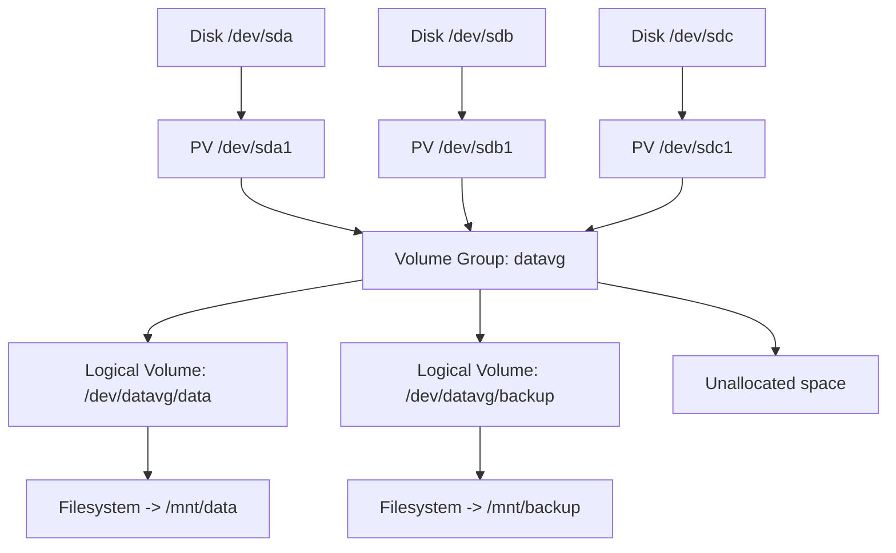
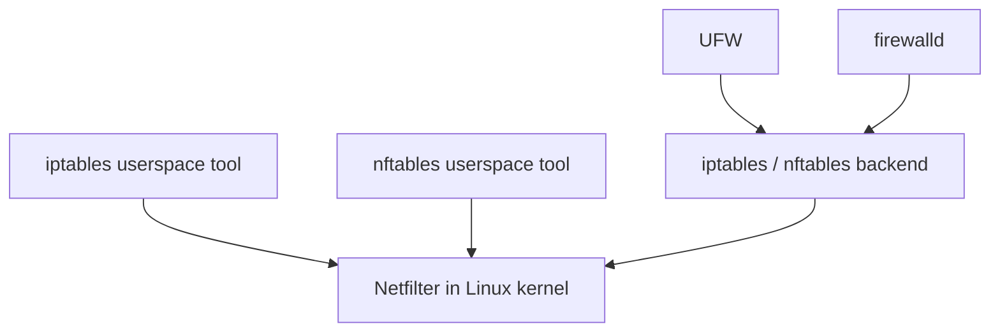
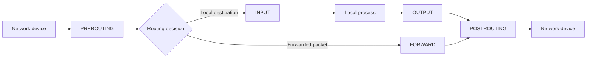
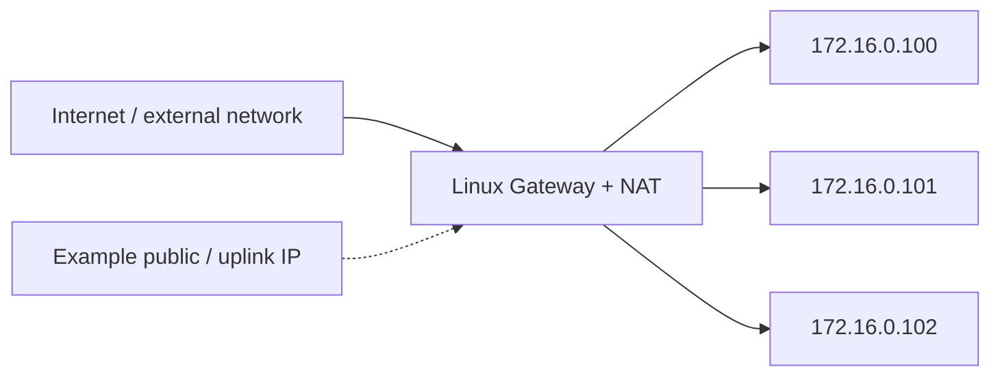
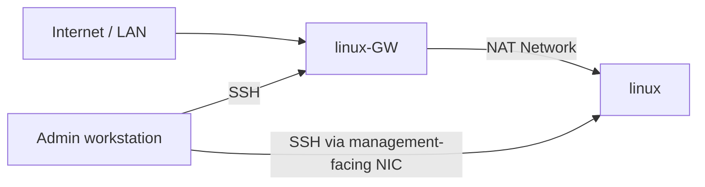
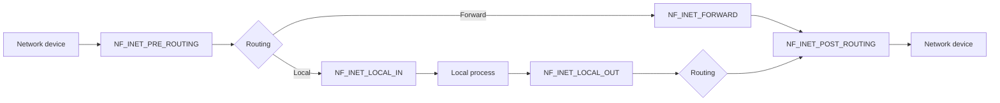
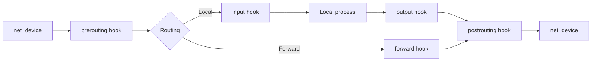

# Milad Norouzi Linux Course Notes

> Scenario-oriented study notes created while watching and practicing Milad Norouzi's free Linux / DevOps course.


## About This Document

These notes started as **personal study notes** while following the course episode by episode. During the videos, I wrote down the commands, explanations, practical tips, and scenario-based exercises that I found useful. Later, the notes were reorganized and cleaned up into this single document so they can be useful to other learners as well.

- **Course & teaching:** Milad Norouzi
- **Source:** the free Linux / DevOps video course linked below
- **Purpose:** a practical companion to the videos, focused on commands, scenarios, and quick review


## Course Resources

- **Linux course playlist:** <https://www.youtube.com/watch?v=Q9gyXqYhL84&list=PLbVuSw3bIGy3r-2EXYqgHdDEoRHzNogMT>
- **GitHub:** <https://github.com/InfraArtists>
- **Telegram Group:** <https://t.me/infraartists_group>

## Course Index

- [E-01 — Virtualization Tools & ISO Images](#e-01)
- [E-02–04 — sudo Setup & User Privileges](#e-02-04)
- [E-05 — OS Preparation & VM Templates](#e-05)
- [E-06 — Documentation with Markdown](#e-06)
- [E-07 — Package Management Overview](#e-07)
- [E-08 — Debian Low-Level Package Management — dpkg](#e-08)
- [E-09 — Debian High-Level Package Management — APT](#e-09)
- [E-10 — Debian Package Management — aptitude](#e-10)
- [E-11 — Red Hat Low-Level Package Management — RPM](#e-11)
- [E-12 — Red Hat High-Level Package Management — YUM / DNF](#e-12)
- [E-13.01–13.09 — Vim](#e-13-01-13-09)
- [E-14–22 — Linux Command Line](#e-14-22)
- [E-23–24 — Terminal Sessions — tmux & Byobu](#e-23-24)
- [E-25–27 — System, Disk & Network Monitoring](#e-25-27)
- [E-28–29 — User & Group Management](#e-28-29)
- [E-30–32 — Disk Management](#e-30-32)
- [E-33–36 — LVM — Logical Volume Manager](#e-33-36)
- [E-37–38 — NFS — Network File System](#e-37-38)
- [E-39–40 — Inodes & Filesystem Usage](#e-39-40)
- [E-41 — File Permissions](#e-41)
- [E-42 — Aliases](#e-42)
- [E-43 — Hard & Soft Links](#e-43)
- [E-44–46 — cron & at](#e-44-46)
- [E-47–52 — Networking](#e-47-52)
- [E-53–56 — SSH](#e-53-56)
- [E-57 — SCP](#e-57)
- [E-58 — rsync](#e-58)
- [E-59 — Fail2ban](#e-59)
- [E-60–70 — iptables](#e-60-70)
- [E-71–75 — nftables](#e-71-75)

---

<a id="e-01"></a>
## E-01 — Virtualization Tools & ISO Images

* **Linux:** VirtualBox
* **Windows:** VirtualBox / VMware + MobaXterm + WinSCP
### ISO Images
* Ubuntu 24.04 LTS (or Debian 12 → `debian-12.8.0-amd64-netinst.iso`)
* Rocky Linux 9.5 (Minimal ISO)
### Editor
* **Windows:** VS Code / Notepad++
* **Linux:** Vim

---

<a id="e-02-04"></a>
## E-02–04 — sudo Setup & User Privileges

* Install with sudo on debian
```
usermod -aG sudo mori
```
* must be in sudo ...
```
id mori
```

---

<a id="e-05"></a>
## E-05 — OS Preparation & VM Templates

* Preparing OS
  * see my ip:
```
ip -br a
```
* for login with user mori ( passwordless ) ,make this file and add string...
```
nano /etc/sudoers.d/mori
mori ALL=(ALL) NOPASSWD: ALL
```

* make Templates :
  * Ubuntu
  * Debian
  * Rocky

* make clone from Ubuntu :
  * ( Ubuntu + Docker )
  * ( Ubuntu + Docker + Kubernetes )
  * ( Ubuntu + Gitlab ) ...

---

<a id="e-06"></a>
## E-06 — Documentation with Markdown

* Documentation
  * Deploy Service -> make Document -> Deploy again service with this Document  .
* Best practice for documentation:
  * **Markdown format (`.md`)** — write it in VS Code; useful extension: Markdown All in One.

* Largest Markdown heading example: `# Install Zabbix`

* Preview Markdown output:
  * `Ctrl + Shift + V`

* Smaller heading: `## Install Packages`
* Smaller again: `### Test`

* Bold: use `**` before and after the text.
  * **this is bold**

* For Bash code blocks, use triple backticks with `bash`:
```bash
mkdir /etc/haproxy
```

* For YAML code blocks:
```yml
api:
kind:
metadata:
  name:
  label:
```

* For SQL code blocks:
```sql
select * from table1
```

* For a generic code block:
```
any
```

---

<a id="e-07"></a>
## E-07 — Package Management Overview

* Installing Packages
  * Low level: download & install (Debian: `dpkg` — Red Hat: `rpm`)
  * High level: package manager (Debian: `apt-get` / `apt` — Red Hat: `yum` / `dnf`)

* Package reference site:
  * <https://pkgs.org>
  * Useful for finding official package builds and package details.

---

<a id="e-08"></a>
## E-08 — Debian Low-Level Package Management — dpkg

* list packages :
```bash
dpkg -l
```

* download from ( pkgs.org )
* example : aria2 ( download manager )

* search aria2 in pkgs.org => url
```bash
wget url
ls
```

* install: ( copy full .deb fileName )
```bash
dpkg -i file.deb
```

* Files that Copied in my OS after installation:
```bash
dpkg -L aria2
```

* This File is from which package? ( S : search )
```bash
dpkg -S /usr/share/doc/aria2/xmlrpc/aria2mon.gz
```

* Contains of Package .deb :
```bash
dpkg -c libssh2-1t64_1.11.0-4.1build2_amd64.deb
```

* remove package  ( only packageName ):
```bash
dpkg -r aria2
```

* remove & purge :
```bash
dpkg -P aria2
```

* help
```bash
dpkg --help
```

* status
```bash
dpkg -s aria2
```

* now download with aria2 : (c : command):
```bash
aria2c url
```

---

<a id="e-09"></a>
## E-09 — Debian High-Level Package Management — APT

* User must be in sudo group .

* Update lists on Remote Repository with list in my OS :
```bash
apt update
```
* First Time : GET
* Second Time : Hit ( cached )

* Upgradables:
```bash
apt list --upgradable
```

* install
```bash
sudo apt install packageName
```

* Bang Bang : !!
```bash
apt install aria2 ( .. error )
sudo !!
```

* -y
```bash
apt install -y nginx aria2
apt -y install nginx aria2
```
* Upgrade ( All Packages)
```bash
apt upgrade -y
```

* remove package :
```bash
apt remove aria2 -y
```

* delete with dependency:
```bash
apt autoremove
```
* Delete Completely
```bash
apt purge nginx
```

* Delete .Deb files after installation:
```bash
apt clean
```
* Search in cached Apps:
```bash
apt-cache search nload
```

* See full data of installed package
```bash
apt-cache show curl
```

* See Dependency of Package and more ...
```bash
apt-cache showpkg nginx
```

* See Only Dependency of package
```bash
apt-cache depends nginx
```

* help
```bash
apt --help
```

* distupgrade (Update Os...)
```bash
apt dist-upgrade
```

* Find upgrade of os & upgrade to that ...Not recommended for Production :
```bash
do-release-upgrade
```

---

<a id="e-10"></a>
## E-10 — Debian Package Management — aptitude

* installing aptitude
```bash
apt install aptitude
```

* Aptitude commands...
```bash
aptitude install nginx
aptitude update
aptitude upgrade
aptitude --help
```

* hold & unhold
  * so, if type : (apt update -> every package upgrade except : nginx)
```bash
apt hold nginx
```

* Download .Deb file of package with apt | aptitude download :
```bash
apt download nginx
```

* How Add repository in ubuntu :
  * all packages is not in ofiicial repository . for Packages that isn't in official packages , must add repo in : /etc/apt/sources.list.d/app.list , then app get packages from url in this list .

---

<a id="e-11"></a>
## E-11 — Red Hat Low-Level Package Management — RPM

* sites for package : (packages end with : .rpm)
  * pkgs.org
  * rpmfind.net

* copy package from my local to server ( **to home directory root** )
```bash
scp packagename.rpm root@192.168.10.10:
```

* for install :
  * -i :  install
  * -v : verbose
  * -h : show Hash sign ..
```bash
rpm --help
rpm -ivh zip-3.0-35.el9.x86_64.rpm
```

* query from rpm: ( show Full packageName)
```bash
rpm -q zip
```

* query list from rpm ( show all files that copy in os after installation)
```bash
rpm -ql zip
```

* query from rpm that this file is from which package ?
```bash
rpm -qf /usr/share/doc/zip/algorith.txt
```

* query from rpm that show info from package Installed
```bash
rpm -qi zip
```

* query from rpm that show info from .rpm package downloaded ( p : package )
```bash
rpm -qip zip-3.0-35.el9.x86_64.rpm
```

* query from rpm that show dependencies from package downloaded
```bash
rpm -qpR zip-3.0-35.el9.x86_64.rpm
```

* query from rpm that show configuration files of installed package : ( c: configuration File)
```bash
rpm -qc zip
```

* query from rpm that show all packages installed in my os
```bash
rpm -qa
```

* Upgrade exist package to new version
```bash
rpm -Uvh zip-3.0-35.el9.x86_64.rpm
```

* remove package : ( -e : erase )
```bash
rpm -e zip | rpm -ev zip
```

---

<a id="e-12"></a>
## E-12 — Red Hat High-Level Package Management — YUM / DNF

* for add repo :
```bash
cd /etc/yum.repos.d/
cat rocky.repo
```

* which repos is enabled ?
```bash
yum repolist
yum --help
```

* install wget
```bash
yum install wget | dnf install wget
dnf --help
```

* many packages exist in : **epel-release** Repo :
```bash
yum install epel-release -y # Download and enable epel-release repo
yum install aria2 -y
```

* for remove
```bash
yum remove -y wget | dnf remove -y wget
```

* search in repo :
```bash
yum search firefox
```

* see dependencies of packages :
```bash
yum deplist wget
```

* see all packages that enabled and exists in repos :
```bash
yum list
```

* see packages that installed in my os :
```bash
yum list installed
```

* see availabale updates for installed package :
```bash
yum check-update
```

* for update : ( First command after os installation )
```bash
yum update
yum update vim # ( update one package)
```

* group install :
```bash
yum groupinstall developertools
```

* download rpm of package with :  yumdownloder
```bash
yum install yum-utils
yumdownloader --destdir /tmp firefox
# also download dependencies of firefox:
yumdownloader --destdir /tmp --resolve firefox
# with dnf:
dnf download firefox --resolve
```

* what happend ?
```bash
yum history | cat /var/run/yum.log | cat /var/run/dnf.log
```

---

<a id="e-13-01-13-09"></a>
## E-13.01–13.09 — Vim

* install vim
```bash
apt install vim
vim --version
```

* arrow keys : ( h - j - k -l )
  * Left:  h
  * Down:  j
  * Up:    k
  * Right: l

* multi line to right,left,down,up :
  * 5h  --> 5 **word** to **left** from cursor ...
  * 10j --> 10 **line** to **down** from cursor ...
  * 8k  --> 8 **line** to **up** from cursor ...
  * 6l  --> 6 **word** to **right** from cursor ...

* Jump words: ( w - e - b )
  * w : jump to **start** of next word
  * e : jump to **end** of next word
  * 5w : jump to start of **5**  word later...
  * 5e : jump to end of **5**  word later...
  * b : back
  * 3b: 3 back ...

* Jump lines: ( 0 - ^ - $ - gg - G)
  * 0 | ^ : jump to **start of line**
  * $ : jump to **end of line**
  * 40gg : go to line 40
  * gg : go to line 1
  * G : go to **end of file**

* go to insert mode ( i - a - I - A - o - O )
  * i : insert ( before last character ) (when we are end of line)
  * a : append ( go insert mode after last character  ) (when we are end of line)
  * press **esc** to exit from insert mode and go to command mode .
  * I : go to first of line and go to insert mode . (when we are in middle)
  * A : go to end of line and go to insert mode . (when we are in middle)
  * o : new line below cursor and insertmode .
  * O : new line up cursor and insertmode .
  * 10o + 2(esc) : open 10 new line below cursor ...
  * 15O + 2(esc) : open 15 new line up cursor ...

* replace a character without go to insert mode: ( r - R - cc - cw )
  * r + newcharacter
  * 5re : **replace 5 character with : e**
  * R : go to **Replcae mode** . in the end : **esc** to back to command mode .
  * cc : **Delete line** and go to insert mode. ( c: clean )
  * 3cc : **Delete 3 line** and go to insert mode.
  * cw : **Delete word** and go to insert mode.
  * 5cw: **Delete 5 word** and go to insert mode.

* Delete ( in action : **cut**) ( x - dw - d^ - d$ - dd - dap )
  * x : Delete a character in **command mode**.
  * 5x : Delete 5 character ...
  * dw : Delete a word ... ( Delete Word )
  * 6dw : Delete 6 word ...
  * d^ : delete from cursor to first of line .
  * d$ | D: delete from cursot to end of line .
  * dd : delete line ( cursor is ane where in line ) .
  * 7dd : delete 7 line from this line and below of it ...
  * dap : delete a paragraph .

* Copy & Paste ( yy - p )
  * p : paste to below of cursor from : ( cutted from before step ... )
  * P : paste to up of cursor
  * yy : copy line .
  * 3yy : copy 3 line .

* search ( / - n - N )
  * /pattern : in command mode . ( example : /login)
  * n : find next word from first to last .
  * N : find from last to first
  * **:set ic** .... then : **/host** ... (for search case insensitive) ... rollback : **:set nohls**
  * **:set hls** .... then : **/host** ... (highLight search word) ... rollback : **:set noic**
  * **:set number** add number first lines
  * **:set nonumber**
  * **:! command** in vim run command and back to vim again .
  * this switch's don't save (:set ...) , we do type any time open a file , for permanently : in home ( root : /root -  nonroot : /home/user) make file : **.vimrc** . write in this file by **viml** syntax ...
  * Add **:set number** in **.vimrc** , then any time open a file with vim , numbers is first of lines .

* UNDO ( u )

* Search and replace : ( s/old/new/g )
  * in command mode **:s/old/new/** + Enter ( replace old to new **only in first find** )
  * **:s/old/new/g** + Enter ( replace old to new in all words finded **in line**  )
  * **:%s/old/new/g** + Enter ( in file)
  * **:%s/old/new/gc** + Enter ( in file + **Confirm** )
  * **:%s/old/new/gic** + Enter ( in file + **CaseInsensitive** + **Confirm**  )

* Save File
  * in command mode : ( **:w** ) = ( **ctrl + s** in windows )
  * **:w + space + name | /path/name** ( **save as** ...) (:w file1.txt | :w /etc/file1.txt)
  * **:q + Enter** ( quit )
  * **:q! + Enter** ( quit and **ignore** changes) | **ZQ**
  * **:wq + Enter** ( Save and Quit ) | **ZZ** | **:x**
  * **:wq! + Enter** ( Save if you can , Ignore and quit if you can't)
  * **:e! + Enter** ( Ignore changes , and reload file from disk again ) ( **while you don't save** ... )

* TAB
  * **:tabnew** : add a new tab .
  * **:tabnext** : switch to next tab .
  * **:tabprevious** : switch to prev tab .
  * **:new /path/to/fileName** : open another file .
  * **ctrl + ww** : switch between files that opened by vim  .

* vimdiff
  * **vimdiff file1 file2**
  * **:diffget** (from where cursor exist...)
  * **:diffput** (from where cursor exist...)
  * **ctrl + ww** : switch between files that opened by vim  .

* Visual Mode | Visual Block
  * **ctrl + v** in command mode, then select....up | down | right | left ... then press **p** to paste anewhere...
  * **ctrl + v** ... select ... **shift + i** ... **shift + 3 (#)** ... **esc** ...(add # to first of line that selected !)
  * **ctrl + v** ... select ... **shift + u (U)** --> UPPER CASE
  * **ctrl + v** ... select ... **u** --> LOWER CASE

* plugin
  * install plugin with : download plugin and copy in home user
  * install plugin with apt ...
  * install plugin with plugin manager : **vim-plug** , **vundle.vim** , **vim-pathogen**
  * install vim-plug with github...
  * install **terminal-env** from github milad to custom terminal ...

---

<a id="e-14-22"></a>
## E-14–22 — Linux Command Line

* list name of files
```bash
ls -a1
ls --help
```

* echo without go to next line
```bash
echo -n "devops # linux"
echo -e "devops \n linux" # linux in next line
echo -e "devops \t linux \t ubuntu" # tab between words ...
echo --help
```

* n command together :
```bash
ls /home ; ls /tmp
ls /home ; ls /tmp ; cd /var
```

* n command together : ( AND )
```bash
apt update && apt upgrade
```

* n command together : ( OR )
```bash
ls /tmp || ls /var
```

* Previous command Executed correctly or not ?
```bash
ls -ltrh
echo $?      # if result is : 0 ----> ls Executed Correctly .
```

* see processID of this shell :
```bash
echo $$
```

* Run Prevoius Command with **BANG BANG !!**
```bash
ls /tmp
!!
```

* Run LAst command that started with : cat ( cat is example )
```bash
cat ~/.bash_history
cd /var
ping 1.1.1.1
ls /tmp
echo hello morteza
!cat
!pi
```

* search in bash_history with ctrl + r
  * ctrl + r ....> then type **ping** .... > then press **ctrl + r** to search in ping commands ...

* run prevoius command with sudo :
```bash
ls /root/
sudo !!
```

* history
```bash
cat ~/.bash_history # data is here
history -c # clean history but exist in file bash_history
\> ~/.bash_history # clean file
```

* see os details ...
```bash
uname
# Linux
uname -r
# 5.15.0-161-generic
uname -i**
# x86_64
uname -o
# GNU/Linux
uname -a
# Linux ubuntu-01 5.15.0-161-generic #171-Ubuntu SMP Sat Oct 11 08:17:01 UTC 2025 x86_64 x86_64 x86_64 GNU/Linux
uname --help
```

* man
  * man ls
```bash
man -w ls
# /usr/share/man/man1/ls.1.gz
man -f ls
ls (1)               - list directory contents
```

* command output
  * 0 : stdin
  * 1 : stdout
  * 2 : stderr

* get string from user and insert in new file
```bash
cat > file2
# salam
# chetory
# new line
# for exit : ctrl + d
```

* cat
```bash
cat file1 - file2 > file3 # merge file1 & 2
cat -n
cat --help

tac file # from last to first
tac --help
```

* tr ( translate )
```bash
echo "this is for test" | tr is IS
tr --help
echo "this is for test" | tr [:lower:] [:upper:]
cat file1 | tr [:lower:] [:upper:] > file2
echo "this is for test" | tr [:space:] "\t"
echo "this is for test" | tr -d [:digit:] # delete digits...
echo "this is for test" | tr -dc [:digit:] # delete every thing that isn't digit
echo "this is for test" | tr -d t
```

* sort & uniq ( uniq is work on sorted file only)
```bash
sort file1 > sorted_file
sort file1 | uniq
sort file1 | uniq -c    # ( c: count )
sort file1 | uniq -dc    # ( c: count , d : duplicate , repeated 2 or more times...)
sort file1 | uniq -u    # ( only one repeated lines)
```

* split ( base on **Line** & **Size**)
```bash
split --help
split -l 10 file1 file1_output
yes > yes_file # (after 3 second : ctrl + c... 800 MB !)
split -b 100MB yes_file
```

* word count
  * wc file1 ( lines - words - bytes )
```bash
wc -l file1
```

* cut
```bash
cut file1 -d, -f2 | cut -d: -f1
```

* paste
```bash
paste file1 file2
```
* resulet:
  * a       1
  * b       2
  * c       3
  * d       4
  * e       5

```bash
paste --help
paste -d+ file1 file2
```
* result:
  * a+1
  * b+2
  * c+3
  * d+4
  * e+5

* sed ( Stream Editor ) ( g: global )
```bash
# only for view
sed "s/yes/NO/g" sshd_config
# (-i: insert - write to file)
sed -i "s/yes/NO/g" sshd_config
# change in file only in line 95
sed -i "95s/yes/NO/g" sshd_config
sed -i "95,9 6s/yes/NO/g" sshd_config
# sed in special path ( /etc/ssh.........\/etc\/ssh )
sed "s/\/etc\/ssh/yes/NO/g" sshd_config
# sed in 2 path
sed "s|/etc/ssh/ssh_hosts|/home/milad|g"
```

* tee ( write output of command to fle )
```bash
# only write - we don't want to see ..
ls -l > testfile.txt
# write and see ( combine : "ls -l > testfile.txt" & "cat testfile.txt")
ls -l | tee testfile.txt

```

* grep ( select lines of file with pattern )
```bash
grep "YES" sshd_config
# for caseInsensitive
grep -i "YES" sshd_config
# in 2 file ...
grep "YES" sshd_config file1.txt
# see lineNumber of Found line with grep
grep -n "YES" file1.txt
# count found...
grep -c  "YES" sshd_config
# find lines that don't match with pattern
grep -v "YES" sshd_config
# see "yes" in path: /etc/ssh.... -r
grep -i -n -r  "YES" /etc/ssh | grep -rni "YES" /etc/ssh
# match with exactly match
grep -w "YES" /etc/ssh
# see 1 line before matched line too ..
grep -n -B1 "YES" /etc/ssh
# see 2 line after ...
grep -n -A2 "YES" /etc/ssh
# see 2 line Before and After ....with C ( center )
grep -n -C2 "YES" /etc/ssh
# pass to another grep ...
grep -n -C2 "YES" /etc/ssh | grep Forwarding
grep -n -C2 "YES" /etc/ssh | grep Forwarding | sort | uniq | cut -d, -f1
```

* touch
```bash
touch file1
touch f{1..10}
ls ? # one character
ls ??
rm ? # delete one character files
mv ??? /tmp/
ls {*.png,*.pdf}
touch -t 200810271645 file2
stat file3
```

* **Find**
* search files or directory that sync with mori in /
```bash
find --help
find / -name mori
```
* search files or directory that sync with mori in / **case Insensitive**
```bash
find / -iname mori
```
* search files : mori in /
```bash
find / -iname mori -type f
```
* search dir : mori in /
```bash
find / -iname mori -type d
```
* search link : mori in /
```bash
find / -iname mori -type l
```
* find *.pdf files && copy to another path ...or delete
```bash
find / -iname *.pdf -exec cp {} /home \;
find / -iname *.pdf -exec rm -rf {} \;
```
* find by size ...
```bash
# size between 1 , 5 KB
find /etc/ -type f -size +1k -size -5k
# find empty files
find / -empty
```
* search files that change time < 120 minute
```bash
find / -cmin -120
```
* \> 120
```bash
find / -cmin +120
```
* delete file greater than 5GB from /
```bash
find / -type f -size +5G -exec rm -rf {} \;
```

* see type of file
```bash
file file1.png
```

* Compress & Archive
  * compress: ( zip - GNU zip (gzip) - bzip2 - xz )
  * archive: tar

* **zip** ( main file exist ...)
```bash
yes > file1.txt
zip file_zip.zip file1.txt
ls -lh
unzip file_zip.zip

# for dir
zip -r dir1.zip dir1/
ls -lh
unzip dir1.zip
zip --help
```

* **gzip** ( main file move to gz ...)
```bash
gzip file1.txt
gzip -9 file1.txt # ( more compress ...)
ls -lh   # ( file end with : .gz )
gunzip file1.txt.gz
gzip --help
```

* **bzip2** ( newer  - more time  - better compress )
```bash
bzip2 --help
bzip2 file1.txt
ls -lh # ( file end with : .bz2 )
bunzip2 file1.txt.bz2
```

* **xz** ( newer - exist in new distro - have power of bzip2 & speed of gzip )
```bash
xz --help
xz file1.txt
ls -lh # ( file end with : .xz )
unxz | xz -d file.txt.xz
```

* **tar** (archive)
```bash
tar --help
# only archive
tar -cvf dir.tar dir1
tar -xvf dir.tar
# archive & compress (z zip)
tar -cvzf dir.tar.gz dir1
tar -xvzf dir.tar.gz
# archive & compress (j bzip2)
tar -cvjf dir.tar.bz2 dir1
tar -xvjf dir.tar.bz2
```

* **dd** ( copy )
  * if: input file
  * of: output file
```bash
dd if=file1.txt of=/tmp/file_dd.txt
```
* copy disk with partitioning to another disk ...with **dd**
```bash
dd if=/dev/sda of=/dev/sdb
```
* test read & write on disk with dd
```bash
dd if=/dev/zero of=/tmp/rand_file
# write 1000 block of 1MB to rand _file ...... generate file 1000MB
dd if=/dev/zero of=/tmp/rand_file bs=1M count=1000
```

---

<a id="e-23-24"></a>
## E-23–24 — Terminal Sessions — tmux & Byobu

### tmux ( Recommended )
```bash
apt install tmux
apt install byobu
```
* run command in tmux , if net disconnected , or terminal closed , we have running command in tmux :
```bash
tmux
# then run command , for example : cp file1.txt /tmp ..
# close terminal ... or disconnect from internet...
tmux ls
tmux att -t 0
# for Detach :
(ctrl + b ) d
# Horizontal Split :
(ctrl + b ) %
# Vertical Split :
(ctrl + b ) + '"'
# switch between splits ...
(ctrl + b ) o | (ctrl + b ) Arrow keys ...
# for exit from any split :
(ctrl + d)
```
* see help of command in tmux :
```bash
(ctrl + b ) ?
```
* new window ( c-b : ctrl + b)
```bash
c-b c
```
* for switch between windows :
```bash
c-b 0 # Go to First window
c-b 1 # Go to Second window
c-b 2 # Go to Third window

c-b n # next window
c-b p # previous window
```

### byobu
* make new window :
```bash
f2
```
* switch between windows :
```bash
f3 # go to previous
f4 # go to next
```
* Detach :
```bash
f6
```
* split :
```bash
shift + f2
ctrl + f2
```
* switch between splits:
```bash
shift + f3
shift + f4
```
* exit from any split or windlow :
```bash
ctrl + d
```
* we can keep state of ubuntu on user that run command in byobu ...
```bash
ssh root@192.168.1.1
byobu-enable
# when login with root again , we Enter in byobu mode !
```

---

<a id="e-25-27"></a>
## E-25–27 — System, Disk & Network Monitoring

### System Monitoring:
* **ps** (process status)
```bash
ps --help
#tty : terminal type (console - ssh)
console : tty1...tty6
ssh     : pts/0
```
* list of all process with user that run command
```bash
ps -a -u
```
* with all process that don't attach in your bash ....All process of system
```bash
ps -a -u -x | ps -aux
ps -aux | grep init
```
* grep is a process ... if you want to don't see grep process :
```bash
ps -aux | grep init | grep -v grep
```
* see process with parents ...
```bash
ps -fax
```

**pgrep** (process grep)
* run process in background with **&**
```bash
sleep 30 &
```
* see process ID's that has "sleep" :
```bash
pgrep sleep
pgrep mysql
pgrep --help
pgrep -c sleep # count
pgrep -n sleep # newest
```

* **top**
```bash
top
```
* load average :
  * last 1 minute
  * last 5 minute
  * last 15 minute
* by default everey 3 second refresh
* for change : ( to everey 1 second :)
```bash
d
1
```
* make colorize :
```bash
z
```
* see full command :
```bash
-c
```
* for kill command :
```bash
-k
```
* sort by memory ( m ) and by process | cpu ( p )
```bash
shift + m
shift + p
```
* see cpu's detail :
```bash
1
```
* see cpu detail with progress ar :
```bash
ltm
1
```
* Quit :
```bash
q
```

* **htop**
```bash
htop
```
* sort by memory ( m ) and by process | cpu ( p )
```bash
shift + m
shift + p
```
* **btop** (newer)

* **jobs**
  * how see commands in background ?
```bash
sleep 1000 &
sleep 300 &
jobs | jobs -l
ps -aux | grep sleep | grep -v grep
ps -ef | grep sleep
pgrep sleep
```
* how kill a process ?
```bash
kill 1762 # pid
```
* signals :
  * SIGINT ==> 2 ( ctrl + c )
  * SIGQUIT ==> 3 ( ctrl + d )
  * SIGTERM ==> 15 ( kill ) ( nice ... ! )
  * SIGKILL ==> 9 ( kill -9 ) ( Danger ! )
```bash
kill -s SIGKILL | kill -n 9
```
* kill all process with match : sleep
```bash
killall --help
killall sleep
```
* pkill ( processKill)
```bash
pkill sleep # terminate all sleep process
```

* free ( monitoring memory )
```bash
free
free -h
free -m  # ( mebibytes )
free -g  # ( gibibytes )
free -t  # ( total )
free -th
free --help
```

* uptime
```bash
uptime
uptime -p  # ( pretty )
uptime -s  # ( from when .. )
```

* install some tools for load & monitoring
```bash
apt install stress-ng ( make load on cpu,ram,io , .... )
apt install sysstat
apt install iotop ( for io )
apt install nload ( for network )
apt install iftop ( for network )
apt install iperf ( for BandWidth)
apt install net-tools
apt install iptraf-ng -y
```

* vmstat  ( in package : sysstat )
```bash
vmstat  # ( ... like free ... )
vmstat --help
vmstat -d  # ( disk )
```

* stress-ng
```bash
stress-ng -c 1   # ( Enter load on 1 core of cpu ... 2: 2 core of cpu ... N )
stress-ng -m 10  # ( load 10 virtual memory ...)
stress-ng --hdd 3  # ( load on hdd ... io ...)
```

* sar ( stats of cpu at time)
```bash
sar 1 10  # ( every 1 second ...)
sar --help
```

### Disk Monitoring:
* iotop ( disk state ... )
```bash
iotop
```

* system is slow.... what we do ?
```bash
# 1
htop
# 2
iotop
```
### Network monitoring :
* ifconfig ( in package : net-tools )
```bash
# check RX & TX & count af package sent , count of error ...
ifconfig
netstat -ie
# check count of package sent & receive by protocol :
netstat -s
netstat --help
# check route :
netstat -r
# see open ports
netstat -ntlp
```

* iftop
```bash
# which package is go out from system , or enter in system
# in download for example
iftop
iftop --help
```

* nload
```bash
# state of incoming & outgoing . switch between NIC with arrow keys
nload
```

* iptraf
```bash
# state of sent & receive of packages...
iptraf
# choose a interface
iptraf-ng -i ens0s8
```

* iperf ( see max BandWidth between Two server )
```bash
apt install iperf
# iperf must be exist in 2 server
# choose 1 server : server  second server : client .
# in server :
iperf -s
# in client :
iperf -c 192.168.1.1    # then see bandwidth ...
```

* tcpdump ( package capturing )

---

<a id="e-28-29"></a>
## E-28–29 — User & Group Management

* any user has a id
```bash
id
```
* uid=0(root)
* gid=0(root)
* groups=0(root)

```bash
# in user root :
id mori
```

* see users :
```bash
cat /etc/passwd
# users with id < 1000 : system users . ( no login )
```

* make a user
```bash
useradd   # better than adduser
useradd --help
useradd -m  # make home directory
useradd -d /path # change home directory path
useradd -c "comment"  # set comment
useradd -s /bin/bash  # choose bash
useradd mori
useradd -m -d /mnt/mori -c "admin user" -s /bin/bash mori
```

* set password
```bash
passwd mori
```

* any new user after login , see this files in home directory :
  * **.profile**
  * **.bashrc**
  * **.bash_logout**

  * this files come from : /etc/skel/
  * if we copy any file to : /etc/skel/ ==> copy to newUser homeDirectory

* usermod ( edit user )
```bash
usermod --help
usermod -c  # comment
usermod -d  # change home directory
usermod -g  # change groupID
usermod -G  # change Additional Groups
usermod -s  # change shell
usermod -L  # lock
usermod -U  # unlock

usermod -s /bin/bash mori
# change primary group of user mori to devops ( First: Group - Second: User )
usermod -g devops mori
# add (append) user mori to sudo : ( First: Group - Second: User )
usermod -aG sudo mori
```

* userdel ( delete user )
```bash
userdel --help
userdel -f  # force
userdel -r  # remove home directory
userdel -rf mori
```

* groupadd
```bash
groupadd --help
groupadd group1
# see groups :
cat /etc/group
# add group with id 1100
groupadd -g 1100 group2
```

* groupmod
```bash
groupmod --help
groupmod -g # change id
groupmod -n # change name
groupmod -n newgroup group1
tail -n 5 /etc/group
groupmod -g 1200 newgroup
```

* groupdel
```bash
groupdel newgroup
```

* passwords is in /etc/shadow
  * ! means : password can be set for this user
```bash
# see details of password ... expire & ....
chage -l mori
# for change :
chage mori    # step by step change ...
```

---

<a id="e-30-32"></a>
## E-30–32 — Disk Management

* 3 step to use disk
  * **Detect**
  * **Partitioning** ( MBR or GPT )
  * **Format**

#### how assign disk to linux ?
* 1: make dir ( ex: /mnt/data )
* 2: make partition
* 3: assign Partition1 to /mnt/data1
* 3: assign Partition2 to /mnt/data2 ...

#### Steps :
* 1: Detect
* 2: Partitioning
* 3: file system
* 4: mount

#### **1: Detect** ( see disks in linux - check for **detect** disk )
#### tools:
* lsblk
* ls /dev/sd*
* fdisk -l
```
lsblk
ls -lah /dev/sd*
fdisk -l
```

#### **2: Partitioning**
#### tools:
* **fdisk** ( MBR ) *
* **gdisk** ( GPT)

#### MBR & GPT
* MBR : up to 4 Partition ( 3 Primary - 1 Extended ( here can define logical volume - multi partition ) )
* GPT : up to 128 Partition ( any partition : 8 ExaByte )

#### partitioning on sdb(20G) with **fdisk** ( MBR )
```
# see disks :
fdisk -l
# enter to fdisk environment :
fdisk /dev/sdb
--> m ( help )
--> d ( delete partition )
--> p ( print partition table )
--> F ( list free unpartitioned space )
--> w ( write )
--> n ( add a new partition )

--> n
  --> p ( primary )
  --> 1 ( partition number )
  --> First Sector ( Enter )
  --> +5G ( assign space )
--> p
--> n
  --> p ( primary )
  --> 2 ( partition number )
  --> second Sector ( Enter )
  --> +10G ( assign space )
--> p
--> n
  --> p ( primary )
  --> 3 ( partition number )
  --> third Sector ( Enter )
  --> +3G ( assign space )
--> p
--> n
  --> e ( extended )
  --> 4 ( partition number )
  --> fourth Sector ( Enter )
  --> to end of sector ( Enter )
--> p
--> n ( All primary partitions are in use. Adding logical partition 5)
  --> first sector ( partition number )
  --> to where ( +1G )
--> p
--> w
```
#### see last status of disk :
```
lsblk
```

* if we delete extended partition , then logical partition under that ...delete ...
#### change partition type
```
fdisk /dev/sdb
--> t
--> 3 ( choose partition )
--> L ( list partition types - default : 83 linux)
--> 8e ( lvm )
--> p
--> w
```

#### partitioning on sdb(20G) with **gdisk** ( GPT )
```
gdisk /dev/sdb
--> ? # ( help )
--> n # ( new partition )
--> w # ( write )
--> d # ( delete partition )
--> t # ( change type )
```

#### **3: fileSystem**
#### tools:
* **mkfs**
```
mkfs.btrfs
mkfs.ext2
mkfs.ext3
mkfs.ext4
mkfs.fat
mkfs.ntfs
mkfs.xfs

mkfs.ext4 | mkfs -t ext4
```
#### write ext4 on partition ( ex : /dev/sdb2 )
```
mkfs.ext4 /dev/sdb2
mkfs.xfs /dev/sdb1
mkfs -t ext3 /dev/sdb3
```
#### **blkid** ( how see type ? )
```
blkid
```

#### **4: mount**
#### steps :
* 1: make dir
* 2: mount dir to partition

* before mount, if copy data to dir , save to disk os ( sda ) , after mount : if copy data to dir , write to partition on sdb and we don't access to data that written in sda .

* Recommend : make dir with UpperCase ... ( for example : /DATA_SDB1) , for care in Removing !

```
mkdir /DATA_SDB1
mkdir /DATA_SDB2
mkdir /DATA_SDB3
```

#### mount ( mount partition dir)
```
mount /dev/sdb1 /DATA_SDB1/
# see result :
lsblk
# write data on partition that mounted :
cd /DATA_SDB1
touch file{1..10}.txt
ls
```

#### UnMount ( umount partition )
```
umount /dev/sdb1
--> its busy ..
cd ..
umount /dev/sdb1
# see result :
lsblk
```
* if unmount : we don't see data in /DATA_SDB1 , when mount again can see ...
* if we reboot os , **we must create again mountPoint**
#### **Permanent mount**
* for mount **Permanently** , we must define this mount in file : **/etc/fstab**
```
vim /etc/fstab
```
#### fields
* partition
* dir
* filesystem
* write policy ( read only | read write ...) . we choose defaults ( all options )
* 0
* 0

line to be added :
/dev/sdb1 /DATA_SDB1/ ext4 defaults 0 0
#### then :
#### read lines from /etc/fstab and mount
```
mount -a # ( if correct : output is null )
```
#### **Permanent mount** with UUID
* is some distros , when reboot , perhaps /dev/sdb1 change to /dev/sdb2 and /etc/fstab can't mount this partition , so is better than mount with uuid :
```
# find UUID
blkid
# or :
ls -l /dev/disk/by-uuid/
```
#### in /etc/fstab :
```
/dev/disk/by-uuid/eb47e00d-31b9-43fc-b87c-bd255db59478 /DATA_SDB2 ext4 defaults 0 0
mount -a
```

#### choose fileSystem per file usage :

| Scenario | Suggested filesystem |
| --- | --- |
| Normal Ubuntu / general-purpose Linux | `ext4` |
| Heavy storage workloads | `XFS` |
| Millions of small files | `ext4` with inode tuning, or `XFS` |
| VM / Docker / Kubernetes workloads | `XFS` |
| Professional NAS use cases | `ZFS` |
| Feature-rich desktop use cases | `Btrfs` |

---

<a id="e-33-36"></a>
## E-33–36 — LVM — Logical Volume Manager

* **PV** ( Physical Volume ... disk...hardware.. ) ( disk | a partition of disk )
* **VG** ( Volume Group ) ( consist of multi pv )
* **LV** ( Logical Volume ) ( part of vg ) ( linux write data on LV )



#### install lvm
```
apt install lvm2
# add disks and check :
lsblk
```
#### disk - scenario 1
#### make partition on disk and convert this partition to pv
#### we add 2 disk : sdb and sdc
```
fdisk /dev/sdb
--> n
  --> p
  --> 1
  --> Enter
  --> +5
--> p
--> t    # ( to add in lvm must change type)
--> L
--> 8e  ( linux lvm )
--> p
--> w

lsblk
```
```
fdisk /dev/sdc
--> n
  --> p
  --> 1
  --> Enter
  --> +5
--> p
--> t    # ( to add in lvm must change type)
--> L
--> 8e  ( linux lvm )
--> p
--> w

lsblk
```

#### disk - scenario 2
#### make pv from disk ( without partitioning )
#### we add 2 disk : sdb and sdc
```
lsblk
# for create pv
pvcreate /dev/sdb
pvcreate /dev/sdc
pvs
```

#### 1: pv
#### Display pv
* **pvdisplay**: see pv's
* **pvs**: see pv's ( summery )
```
pvdisplay
pvs
```
#### Create pv
* **pvcreate**
```
pvcreate /dev/sdb1
pvcreate /dev/sdc1

# OR
pvcreate /dev/sdb1 /dev/sdc1
# -------
# for create pv without partitioning disk
pvcreate /dev/sdb
pvcreate /dev/sdc
pvs
```
#### Remove pv
* **pvremove**
```
pvremove /dev/sdb1
```
#### scan pv ( check for detect pv)
* **pvscan**
```
pvscan /dev/sdb1
```
#### 2: vg
#### Display vg
* **vgdisplay**
* **vgs**
```
vgdisplay
vgs
```
#### Create vg
* **vgcreate**  name [pv's]
```
vgcreate vg_data /dev/sdb1 /dev/sdc1
vgs | vgdisplay
```
#### extend vg ( add more pv to this vg )
* **vgextend** vgName newPV
```
vgextend vg_data /dev/sdd1
```
#### reduce vg ( remove pv from vg )
* **vgreduce** vgName PV
```
vgreduce vg_data /dev/sdc1
```
#### remove vg
* **vgremove** vgName
```
vgremove vg_data
vgs
```
#### rename vg
* **vgrename** currentName newName
```
vgrename vg_data vg1
vgs
```

#### 3: lv
#### Display lv
* **lvdisplay**
* **lvs**
```
lvdisplay
lvs
```
#### Create lv
* **lvcreate** --name lvName --size size vgName
```
lvcreate --name lv_data --size 6G vg_data
lvs
lsblk
```
##### make file system on lv
* **mkfs** .type /dev/vgName/lvName
```
mkfs.ext4 /dev/vg_data_lv_data
```

##### mount
* **mount**
```
mount /dev/vg_data_lv_data /mnt/
lsblk
```
* vim /etc/fstab
```
# find uuid in :
lvdisplay | ls -l /dev/disk/by-id
/dev/disk/by-id/dm-uuid-LVM-om82PpJGBWI7x3Xo59AHZUxVm2GQguf1EW0E7Y8AA84Wg1qugLjHYa0U4On0KBHP /mnt ext4 defaults 0 0
mount -a
```
* if disk --> partition --> mount --> /dev/disk/by-uuid/
* if disk --> partition --> lv --> mount --> /dev/disk/by-id/

#### remove lv
* **lvremove** path
```
lvremove /dev/vg_data/lv_data
# if in use --> umount
```

#### rename lv
* **lvrename** /path/currentName newName
```
lvrename /dev/vg_data/lv_data lv1
```

#### reduce lv ( NOT RECOMMENDED — data is important! )
* **lvreduce** -L[DestinationSize] path/to/lv
* **less size--> if data grow --> lv extend **
```
# current lv is : 40
lvreduce -L20G /dev/vg_data/lv_data
lvs
```

#### extend lv
* **lvextend** -L[DestinationSize] path/to/lv
```
# current lv is : 40
lvextend -L50G /dev/vg_data/lv_data
lvs
```

#### LVM snapshot
**task**:
* make lv
* write files on it
* snapshot from it
* remove files
* rollback snapshot and access to files

---

<a id="e-37-38"></a>
## E-37–38 — NFS — Network File System

#### we have 3 server :
* NFS-Server-->192.168.178.14
* NFS-Client-->192.168.178.15
* NFS-Client-->192.168.178.16

#### Every server must can ping this Three IP's .

#### in NFS-Server :
#### set hostname:
```
hostnamectl set-hostname nfs-srv
```
#### vim /etc/hosts :
```
127.0.1.1 nfs-srv
```
#### start Deploying nfs-server
```
apt update
apt install nfs-kernel-server nfs-common -y
```
#### define path for nfs-server ( recommend : /mnt/dir | /opt/dir )
```
mkdir /mnt/nfs
ls -l /mnt
```
#### set permission : **nobody:nogroup** to folder : /mnt/nfs
```
chown nobody:nogroup /mnt/nfs
ls -l /mnt
```
* only this Three server communicate with together , no Human's ! So set Permission to 777
```
chmod 777 /mnt/nfs
ls -l /mnt
```

* **vim /etc/exports** ( this file generated after install packages for nfs ... ) ( access control list for filesystems )
```
/mnt/nfs 192.168.178.0/24(rw,sync,no_subtree_check)
cat /etc/exports
```
#### check that everything is Ok & reset nfs-kernel-server
```
exportfs -r
exportfs -a
systemctl restart nfs-kernel-server
systemctl status nfs-kernel-server
```

#### SERVER SIDE ID DONE !
#### Let's Go for CLIENT

#### in all  client's :
```
apt update
apt install nfs-common -y
```
#### make dir in clients ( Recommend : same path in server). in All client's :
```
mkdir /mnt/nfs
ls -l /mnt/
```
#### set permission :
```
chown nobody:nogroup /mnt/nfs
chmod 777 /mnt/nfs
ls -l /mnt/
```

#### mount Client's to server : ( **mount serverIP:/path clientPath** )
```
mount 192.168.178.14:/mnt/nfs /mnt/nfs
# for check in client's :
df -h
```
* Recommend : Permanent mount ( vim /etc/fstab ) ( **filesystem : nfs** )
```
192.168.178.14:/mnt/nfs /mnt/nfs nfs defaults 0 0
# after save vim :
mount -a
```

#### test --> make file in client1 & see it on client2 :
```
## in client1 :
cd /mnt/nfs
ls
touch file1
ls
# in client2 :
cd /mnt/nfs
ls
touch file2_srv2
ls
# in client1 :
ls
# in server :
cd /mnt/nfs
ls
touch file_srv{1..10}
ls
# in client1 & 2 :
ls
```

#### TASK :
* add 2 disk for nfs-srv ( 2 * 20 G for example )
* make lvm from it
* mount this lvm to /opt/nfs ( 40G ) ( pv-->vg-->lv-->mount )
* config nfs based on this lvm storage ( 40G - /opt/nfs )
* in client : make /opt/nfs and mount to /opt/nfs server

---

<a id="e-39-40"></a>
## E-39–40 — Inodes & Filesystem Usage

* files on linux has a metaData that very important for linux . this metadata store in disk with name : **inode** .

```
touch file1
stat file1
```
* in output of stat : this metadata store in disk by inode no : [ in output ]
* every file has a inode , we work with data of file ; but os work with inode .

#### find inode of every file : ( **ls -li** )
```
ls -li file1
```

#### **df** ( disk free )
```
df --help
df -h  # ( human readable )
df -T  # ( print type )
df -t ext4  # ( show disks filter by ext4 )
df -i  # ( inodes )
```
* in **df -i** see count of available free inode , if we touch a new file , in fact 1 inode use ...
```
# Iuse %
df -i
```

#### CHOOSE BEST FILESYSTEM WITH OUR NEED !
* count of inodes , depends on file system ( ext4 , xfs , .... )
* more files with less size ---> use more inode---> inodes full soon--> choose filesystem that more count of inode
* less file with more size ---> use less inode---> choose filesystem that give a better Quality...
#### **choose filesystem per our need**

#### **du** ( disk usage)
```
du --help
du -h  # ( human readable )
du -s  # ( summarize )
du -s /
# search all of /
du -sh /*
# see every thing in /mnt :
cd /mnt
du -sh *
# see hidden files ..
du -ah
```
* **fsck** ( file system check ) ( fsck.ext4 | fsck.fat | ... )
```
fsck /dev/sda2
```

#### tools for check & tune & manage **EXT** disks :
* **tune2fs**
* **dumpe2fs**
* **debugfs**

#### tools for check & tune & manage **XFS** disks :
* **xfs_info**
* **xfs_growfs**
* **xfs_admin**
* **xfs_repair**
* **xfs_db**

#### tools for check & tune & manage **BTRFS** disks :
* **btrfs**
* **btrfsck**
* **btrfs-find-root**
* **btrfs-debug-tree**
* **btrfstune**
* **btrfs-restore**

#### script for fulling inode ... ( vim script.sh )
```
#!/bin/bash
while true
do
touch file_$RANDOM
done
```
#### in another shell :
```
watch -d -n 1 df -i
```
#### then in first shell :
```
bash script.sh
```
* **disk is free , but inodes is full . Be carefull !**

---

<a id="e-41"></a>
## E-41 — File Permissions

#### **chmod** ( u: user - g: group - o: other - a: all )
```
chmod u+r file1
chmod u-r file1
chmod u+rwx file1
chmod u-rwx file1
chmod g+r file1
chmod g-r file1
chmod o+r file1
chmod o-r file1

chmod u+rwx,g+rwx file1

chmod ug=rx,o=x file1

chmod a=rwx file1
```
#### chmod ( 4: r - 2: w - 1: x )
```
chmod 644 file1

# for assign permission to files in dir:
chmod -R  777 dir1/
```

Example output:

```text
-rw-rw-r-- 1 user group 0 Oct 12 09:35 filename
│└─┬─┘└┬┘  │  │    │       │          └─ filename
│  │   │   │  │    │       └─ last modified time
│  │   │   │  │    └─ size
│  │   │   │  └─ group
│  │   │   └─ owner
│  │   └─ permissions for others
│  └─ owner/group/other permission bits
└─ file type (`-` file, `d` directory, `l` symlink, ...)
```

Permission bits:

| Bit | Meaning |
| --- | --- |
| `r` | read |
| `w` | write |
| `x` | execute |
| `-` | permission not granted |

#### TASK
#### ls -l /
#### mnt ---> drwxrwxrwt  ( t? - T?) - rws ( s? )
* **SUID**
* **GUID**
* **Sticky bit**

#### umask ? ( how change permission default ? )

#### **chown** ( change owner and group of file)
```
chown mori:mori file2
chown root: file2   # ( user and group : root )
# dir
chown mori: dir1/
chown -R mori: dir1/
```

#### **chgrp** |( change group only )
```
chgrp root dir/
```

---

<a id="e-42"></a>
## E-42 — Aliases

#### alias mr is only for this user :
```
alias mr='ls -ltrhas'
mr
```
* this alias is not Permanent , work only in this shell . for permanent add this alias in : ( **~/.bashrc | ~/.profile** )
```
# vim ~/.bashrc
alias mr='ls -ltrhas'
```
* system load ==> load file : .bashrc ==> load file : .bash_aliases
* so we can touch file **~/.bash_aliases** and put our aliases in this file .
```
# vim ~/.bash_aliases
alias mr='ls -ltrhas'
alias ig='grep -i'
alias p='ping'
alias v='vim'
```
#### for apply this aliases Defined in ~/.bash_aliases :
```
logout & login
# OR
source .bashrc
# test
cat /etc/ssh/sshd_config | ig Bann
```
* Recommend : backup from .bash_aliases and copy it in Template linux_ubuntu_fresh_Install ...
#### **for see defined aliases** :
```
alias
```
* when in first time login to unknown server , first : check **alias** !

---

<a id="e-43"></a>
## E-43 — Hard & Soft Links

### Core idea

- **Hard Link** -> another filename that refers to the **same inode** and the same underlying file data.
- **Soft Link / Symbolic Link** -> a separate file with its **own inode**; it stores a path to another file or directory.

> With hard links, there is technically no special "original" link after creation. The directory entries are equal names that refer to the same inode.

### Delete behavior

- **Hard Link** -> deleting one filename does not remove the data while another hard link to that inode still exists.
- **Soft Link** -> if the target path disappears, the symlink remains but becomes a **broken / dangling symlink**.

### Permissions

- **Hard Link** -> because all hard links refer to the same inode, they share the same owner, group, mode/permissions, timestamps, and file data.
- **Soft Link** -> the symlink has its own inode, but when accessing the target through the symlink, the **target file's permissions** are what matter. Changing the target's permissions therefore changes whether access through the symlink succeeds.

### Directories and filesystems

- **Hard Link** -> normally cannot be created for directories and cannot cross filesystem boundaries.
- **Soft Link** -> can point to files or directories and can point across filesystems.

### Commands

Create a hard link:

```bash
ln source_file hard_link_name
```

Create a symbolic link:

```bash
ln -s target_path symbolic_link_name
```

#### Hard-link example

```bash
ln file1 hard_file1
ls -li                 # file1 and hard_file1 have the same inode

echo hello > file1
cat hard_file1         # same underlying data

chmod 600 file1
ls -l file1 hard_file1 # permissions are the same because the inode is the same

rm file1
cat hard_file1         # still works
```

#### Soft-link example

```bash
ln -s file1 soft_file1
ls -li                 # symlink has a different inode

echo hello > file1
cat soft_file1         # follows the path to file1

chmod 600 file1        # access through soft_file1 is governed by file1 permissions
rm file1
cat soft_file1         # fails: soft_file1 is now a dangling symlink

touch file1
# soft_file1 resolves again because its stored target path exists again
```

#### `unlink`

`unlink` removes one directory entry/name. It can remove a symbolic link, a hard-link name, or a regular-file name; it does not specifically mean "remove a soft link".

```bash
unlink soft_file1
```

- A useful real-world use of symlinks is keeping dotfiles such as `.bashrc` or `.vimrc` in a Git repository and linking them into the expected locations. The symlink keeps working as long as its target path remains valid.

---

<a id="e-44-46"></a>
## E-44–46 — cron & at

* **server: cron**
* laptop: anacron

#### cron : ( * * * * * ) [ command ]
* 1: min --> 0-59
* 2: hour --> 0-23
* 3: dom --> 1-31 ( day of month )
* 4: m --> 1-12 ( month )
* 5: dow --> 0-7 ( day of week ) ( sunday - monday - ... - sunday )

```text
* * * * * command
│ │ │ │ │
│ │ │ │ └─ day of week (0-7; Sunday is 0 or 7)
│ │ │ └─── month (1-12)
│ │ └───── day of month (1-31)
│ └─────── hour (0-23)
└───────── minute (0-59)
```

Common shortcuts:

| Shortcut | Meaning |
| --- | --- |
| `@hourly` | once every hour |
| `@daily` | once every day |
| `@weekly` | once every week |
| `@monthly` | once every month |
| `@yearly` / `@annually` | once every year |
| `@reboot` | once after reboot |

#### **crontab**
* crontab --help
* crontab -l ---> list user's crontab
* crontab -r ---> delete user's crontab
* crontab -e ---> edit user's crontab
* crontab -n ---> dry run : checks the syntax
* crontab -i ---> prompt before deleting user's crontab
* crontab -u user ---> choose the user whose crontab is touched

#### **userLevel**
* first time run crontab : login with user mori
```
crontab -e
--> select editor
--> choose 2 ( vim )
# write this cron :
0 5 * * 1 tar -zcf /var/backups/home.tgz /home/
# save vim and then :
crontab -l
```
#### path of crontab files per user :
* redhat : **/var/spool/cron/username**
* debian : **/var/spool/cron/crontabs/username**
```
cat /var/spool/cron/crontabs/mori  # --> ( in mori : crontab -l )
cat /var/spool/cron/crontabs/root  # --> ( in root : crontab -l )
```
#### see logs of cron :
```
cat /var/log/syslog
```

#### **systemWide** ( Recommended this in real work )
#### we write cron's in this file :
* **/etc/crontab**
* in this file we must define **user** that run this job .

#### we can define file in path : /etc/cron.d
```
# vim /etc/cron.d/backup

* * * * * root  cp  /etc/fstab /mnt/nfs/fstab.bk
```

#### 2 sites that define crontab :
* https://crontab.guru
* https://crontab-generator.org

* we can put our scripts in this dir's to run hourly | weekly | ...
* /etc/cron.hourly
* /etc/cron.daily/
* /etc/cron.monthly/
* /etc/cron.weekly/

#### set **Limitation** that user's ( can | can't) define cron :
#### set what user's **can** define cron ?    ( this recommended !)
* 1: vim /etc/cron.allow
* 2: write username | username's in this file
* note: other user's **Can't** define cron
```
# vim /etc.cron.allow
mori
milad
```

#### set what user's **can't** define cron ?
* 1: vim /etc/cron.deny
* 2: write username | username's in this file
* note: other user's **Can** define cron
```
# vim /etc.cron.deny
reza
```

#### **at**
#### set a schedule for run job in one time ...
```
apt install at
date
at 12:26
# Enter to at environment :
at> ls /etc >> /tmp/at.log
at> cd /var
at> ls -l >> tmp/at.log
at> ctrl + d  ( exit )
```
```
# more example
at 10:00 AM sun
at 10:20 AM may 25
at 10:40 AM 11/22/2026
at 10:50 AM next month
at 11:10 AM tomorrow
at now +1month
at teatime ( 16:00 )
```
#### **atq** ( see at's ? - query )
```
atq
```
#### **atrm [number of at]** ( remove a at )
```
atrm 6
```
#### where save at's ?
```
ls /var/spool/cron/atjobs/
# for see command's written in at : ( at save in a file with Hexadecimal fileName )
cat /var/spool/cron/atjobs/00003hgyfff
```
* set **limitation** for at : ( what user's can | can't write at )
* vim /etc/**at.allow**
* vim /etc/**at.deny**

---

<a id="e-47-52"></a>
## E-47–52 — Networking

#### Recommend to read : CISCO ( CCNA - routing ) + Network+

#### **ifconfig** ( old ... )
```
# in package :
apt install net-tools -y
# see all UP interface :
ifconfig | ifconfig enp0s8
ifconfig --help
--> -a  # ( all interfaces . up & down )
--> -v  # more detail
--> -s  # short detail  ( like : netstat -i )

```

#### **set IP**
```
ifconfig enp0s3 192.168.200.201
```

#### **set NETMASK**
```
ifconfig enp0s3 netmask 255.255.255.0
```

#### **set both**
```
ifconfig enp0s3 192.168.200.201 netmask 255.255.255.0
```

#### **IP & DOWN**
```
ifconfig enp0s3 up
ifconfig enp0s3 down
```
#### hostname
```
hostname
--> -f  # fqdn
```
**add dns server ( hostname ) save to : /etc/resolv.conf**
```
# in ubuntu is link .
ls -l /etc/resolv.conf
lrwxrwxrwx 1 root root 39 Feb 16  2024 /etc/resolv.conf -> ../run/systemd/resolve/stub-resolv.conf
```
**if change /etc/resolv.conf --> service: network manager change to default ...**
```
# so  unlink & new file ...
unlink /etc/resolv.conf
vim /etc/resolv.conf
# set new in vim :
nameserver 8.8.8.8
nameserver 4.2.2.4
```
#### ping google.com ==> first os check file : /etc/hosts
```
# if in hosts :
192.168.1.100 google.com
```
#### ping google.com ==> 192.168.1.100
* if nothing in hosts , search in : **/etc/resolv.conf**
```
# nothing in hosts . in resolv.conf is :
nameserver 8.8.8.8
nameserver 4.2.2.4
```
#### ping google.com ==> [googleIP]
* if nothing in hosts & resolv.conf ==> we can't ping Domain . IP is ok .

#### change hostname :
#### scenario 1
```
vim /etc/hostname
-->
ubuntu2204
vim /etc/hosts
-->
127.0.0.1 localhost
127.0.1.1 ubuntu2204
--> logout & login | bash
```
#### scenario 2
```
hostnamectl set-hostname ubuntu2204
vim /etc/hosts
-->
127.0.0.1 localhost
127.0.1.1 ubuntu2204
--> logout & login | bash
```

#### **route** ( finf route table )
```
route | route -n | netstat -rn
# add default route
route add default gw 192.168.200.1
route -n
# delete route
route del default gw 192.168.200.1
```

#### **ip** ( new )
* ip has more options : has ifconfig, route, tunnel , ...
```
# show ip
ip address show | ip addr sh | ip a s | ip a s enp0s8 | ip as enp0s8 | ip a

# add ip
ip addr add 172.16.10.100/24 dev docker0

# delete ip
ip addr del 172.16.10.100/24 dev docker0

# show interface
ip link show

# up & down interface
ip link set enp0s8 down
ip link set enp0s8 up

# show route
ip route show | ip ro so | ip r s

# add | delete route ( static route )
ip route add 10.10.10.0/24 via 192.168.178.100 dev enp0s3
ip route del 10.10.10.0/24 via 192.168.178.100 dev enp0s3
ip route add default via 192.168.178.100 dev enp0s3
```

#### **ping**
```
ping 192.168.1.1
--> -i 1  # ( every 1 second ... )
--> -I enp0s3  # ( ping with this interface  )
# ping ipv6
ping6
```

* commands : ip , route , ifconfig ... is temp ... for permanent : static IP
#### 2 scenario :
* 1: set static ip in file in linux
* 2: ask from DHCP Server for new IP

#### path in distro's :
* ubuntu --> /etc/netplan/50-cloud-init.yaml  # ( name maybe different )
```
  2 network:
  3   version: 2
  4   ethernets:
  5     ens36:
  6       addresses:
  7       - 192.168.200.200/24
  8 #      gateway4: 192.168.200.2
  9       routes:
 10         - to: 0.0.0.0/0
 11           via: 192.168.200.2
 12       nameservers:
 13         addresses:
 14           - 8.8.8.8
 15           - 1.1.1.1
```
```
netplan try  # is syntax ok ?
netplan apply   # apply & check
```
* Debian--> /etc/networks/interfaces | interfaces.d/interface-01
```
# for apply :
systemctl restart networking.service
```
*  redhat ( rocky )--> /etc/NetworkManager/system-connections/ens33.nmconnection ( deprecated in rocky9 ...) ( or nmcli )
```
[ipv4]
method=manual
addresses=192.168.1.100/24;
gateway=192.168.1.1
dns=8.8.8.8;1.1.1.1;
```
```
sudo systemctl restart NetworkManager
```

#### **T-SHOOT**
* dig ( give ip or domain ) ( first open /etc/resolv.conf and find dns)
```
dig google.com
dig google.com MX  # ( give mail record )
dig google.com NS  # ( give ns record )
dig google.com TXT
dig @1.1.1.1 google.com  # ( ask from dns)
dig +short @1.1.1.1 google.com # ( only ip )
dig -x 175.15.42.11  # ( give domain)
dig +trace google.com
dig --help

```
#### host ( like dig )
```
host 192.168.1.1
host google.com
```

* in dig & host , os first search dns wrote in file : /etc/hosts ( first dns table )

```
192.168.100.100 google.com
```
* then write NS records in /etc/resolv.conf ( os find google.com from dns servers wrote in this file )
```
# first :
unlink /etc/resolv.conf && vim /etc/resolv.conf
nameserver 8.8.8.8
nameserver 4.2.2.4
```
* priority of /ets/hosts upper from all other dns server's

#### see open ports on network os
```
netstat -a
netstat -at  # ( all tcp )
netstat -lt  # ( list tcp )
netstat -lu  # ( list udp )
netstat -ltp   # ( list tcp with program name )
netstat -ltpn   # ( list tcp with program name ) ( n: numeric --- ssh --> 80  https ---> 443  )
# Recommend :
netstat -tulpn
```

#### ss ( link netstat )
```
ss -a
ss -l
ss -lt
ss -altp
ss -lu
ss -au
ss -u
ss -t
ss -at
ss -nltp
ss -nulp
# recommended :
ss -tulpn
```

#### nmap ( scan ip,domain,range ip )
```
nmap localhost
nmap 192.168.178.*
```

---

<a id="e-53-56"></a>
## E-53–56 — SSH

* its Better to login with PUBLIC PRIVATE KEY AUTHENTICATION ( no user root ! )

#### ssh ( secure shell )
* pub / prv key generated in Client side ! any user can define pub/prv key .
* private key : kelid
* public key : ghofl

* first in server must exists this package : **openssh-server**
#### openssh by default listen on port 22
```
# in server side :
apt update
apt install openssh-server
```
#### openssh-server add 3 package to linux :
* openssh-server
* openssh-client
* openssh-sftp-server

#### then we have 2 service :
* ssh.service ==> client side ==> ssh ( from ) ( config : /etc/ssh_config )
* sshd.service ==> server side ==> ssh ( to ) ( in ubuntu 24.04 deprecated ) ( config : /etc/sshd_config )

#### files in ~/.ssh/ :
* known_hosts  ( when we ssh to another server , fingerprint save to this file .) ( useful in client side )
* autrorized_keys  ( useful in server side )

#### Generate Key
```
# generate for user mori in client
cd /users/mori/
ssh-keygen
ssh-keygen --help
-t => type algorithm ( dsa - ecdsa - rsa - ...)
-b => size of key ( -b 4096 )
-f => rename key ( -f mykey )
ssh-keygen -t rsa
ssh-keygen
--> path
--> Enter passphrase ( password for  private key )
--> id_ed25519 & id_ed25519.pub
--> backup from this ... ( like : youbikey )
```

* copy public key to server in path : ~/.ssh/authorized_keys ( vim ---> add to end of file )
* in .ssh in home directory of user that ssh to it ...
```
# in client
ssh-copy-id mori@192.168.1.1 ( user & ip server )
# then ssh to server
ssh mori@192.168.1.1  ( only enter passphrase of privateKey - no need  this passphrase on next ssh until restart server )
```

#### how safe server side
#### in server ==>  request ssh client ==> server =>
* work with pub/prv key of user .
* work with password of user .

#### safe-01 : safe with disable accept password .
* path of config ssh server-side in : /etc/ssh/sshd_config . custom config in path : /etc/ssh/sshd_config.d/*.conf
```
# vim sshd_config

# set port in vim ( next line only )
port 2222
# then in ubuntu :
systemctl daemon-reload
systemctl restart ssh   # ( in other OS : systemctl restart sshd )
ss -tulpn
```
```
# some setting in sshd_config :

# listen to ipv4 & v6
addressFamily any

# listen to special Address IP
ListAddress 0.0.0.0 | ListAddress 175.54.32.198

# Authentication
# when set a pub/prv key and copy public key to server :
# set that user root can not to ssh to server
PermitTootLogin no


# count af admins that Paralell can ssh to server and make a session :
MaxSessions 10 | 4 | ...

# count of wrong password :
MaxAuthTries 6

PubkeyAuthentication yes

# set path of AuthorizekeyFiles :
AuthorizedkeysFile /etc/authorized_keys | ~/.ssh/authorized_keys


# server don't accept password :
PasswordAuthentication no

```

#### some setting in client side in : /etc/ssh/ssh_config
#### better that touch file **config** in ~/.ssh/
```
# vim ~/.ssh/config
Host mci-db1
  HostName 192.168.178.93
  User mori
  Port 22
  IdentityFile ~/.ssh_id_rsa
Host mci-web
  HostName 192.168.178.94
  User morteza
  Port 22
  IdentityFile ~/.ssh_id_rsa

# save vim
```
#### OR
```
# vim ~/.ssh/config
Host mci-*
  User mori
  Port 22
  IdentityFile ~/.ssh_id_rsa
Host mci-db1
  HostName 192.168.178.93
Host mci-web
  HostName 192.168.178.94


# save vim
```
#### OR
```
# vim ~/.ssh/config
Include ~/.ssh/config.d/*
# save vim


# vim ~/.ssh/config.d/mci

Host mci-*
  User mori
  Port 22
  IdentityFile ~/.ssh_id_rsa
Host mci-db1
  HostName 192.168.178.93
Host mci-web
  HostName 192.168.178.94


# save vim
```
```
ssh mci-db1
ssh mci-web
```

---

<a id="e-57"></a>
## E-57 — SCP

#### local to remote
```
# save to homeDirectory of destination
scp file.sh mori@192.168.178.11:
# copy to another path
scp file.sh mori@192.168.178.11:/tmp/script.sh

# copy dir to
scp -r dir1 mori@192.168.178.11:

# copy multi file
scp file1 file2 mori@192.168.178.11:

# if port ssh change :
scp -P 2222 file1 file2 mori@192.168.178.11:
```

#### remote to local
```
scp mori@192.168.200.200:/home/mori/remote.txt .
scp mori@192.168.200.200:/home/mori/remote.txt /opt/file.txt

# copy dir to local
scp -r mori@192.168.200.200:/home/mori/dir1 .

# copy multi file
scp mori@192.168.178.11:/tmp/file1 mori@192.168.178.11:/tmp/file2 .
```

#### scp from server1 to server2
```
scp mori@192.168.178.11:/tmp/file1 morteza@192.168.178.12:/tmp/file1
```

#### Limit BandWidth
```
scp -l 50000 bigfile mori@192.168.178.11:/tmp/bigfile  #  ( 50,000 kb/s - 50 Mb/s - 6 MB/s )
```

---

<a id="e-58"></a>
## E-58 — rsync

* rsync ( copy data from local to remote | remote to local | local to local )
```
rsync --help
-v : verbose
-r : recursive
-a : archive
-u : update new files
-e : remote shell command
--remove-source-files
--compress ( commpress while transfer ) | -z
--bwlimit
```
```
rsync mori.txt mori@192.168.200.200:
rsync -v mori.txt mori@192.168.200.200:

rsync -v mori@192.168.200.200:srv_file .
rsync -v mori@192.168.200.200:srv_file local_file

rsync -vaz dir1 mori@192.168.200.200:  # ( compress only in transmition )
rsync -vaz --progress dir1 mori@192.168.200.200:

# make big file
y > bigfile  ( after 5 second : ctrl + c )
dd if=/dev/zero of=/tmp/test.img bs=1M count=3000

rsync -v --progree test.img mori@192.168.200.200:   # long time ...
rsync -vaz --progree test.img mori@192.168.200.200:  # make archive and compress ... short time ...

# check destination and delete files that not in local | sync 2 dir
rsync -vaz --progress --delete dir1 mori@192.168.200.200:

# if port destination change ..
rsync -e 'ssh -p 2222' -vaz --progress --delete dir1/ dir2/

# exclude ( don't copy .txt files to destination )
rsync -e 'ssh -p 2222' -vaz --progress --delete --exclude '*.txt' dir1/ dir2/
# don't copy .png files & f3.txt ( other can sync ... )
rsync -e 'ssh -p 2222' -vaz --progress --delete --exclude '*.png' --exclude 'f3.txt'  dir1/ dir2/

# --dry-run  ( only show - don't act )
rsync -e 'ssh -p 2222' -vaz --progress --delete --exclude '*.png' --exclude 'f3.txt' --dry-run dir1/ dir2/

# bandwidth ( 1MB ... 1MB ... )
rsync -v --progress bigfile --bwlimit=1024 dir1/ dir2/

# delete from source after move ( mv file dst_file )
rsync -v --progress --remove-source-files mori.txt --bwlimit=1024 dir1/ dir2/

# if file exist in destination don't move ...
rsync -vaz --progress --remove-source-files --ignore-existing  mori.txt mori@192.168.200.200
```
* SCP & rsync needs : password of user files | public key in server side ( ssh must be ok in first )

---

<a id="e-59"></a>
## E-59 — Fail2ban

* how care about attack's to some services in os ...
* is tools that can act on some services and fight with some attacks ...

#### github : https://github.com/fail2ban ( write in python ... )
* fail2ban works with logFile of service ( example log file service ssh )
#### result of fail2ban's act write in log ( log for fail2ban )

#### install in ubuntu
```
apt update
apt install fail2ban
systemctl status fail2ban.service  # it reject some requests by default ...
```

#### path log ssh : /var/log/auth.log
```
# in termenial 1 :
tail -f /var/log/auth.log
```

#### path fail2ban :
```
cd /etc/fail2ban/
ls

# action.d  fail2ban.conf  fail2ban.d  filter.d  jail.conf  jail.d  paths-arch.conf  paths-common.conf  paths-debian.conf  paths-opensuse.conf
```
#### services that fail2ban can act on it , is in /etc/fail2ban/filter.d/
* some default setting is in : **jail.conf** ( like : bantime = 10m | maxretry = 5 )
* Recommend : don't work with jail.conf and make new for we , like : **jail.local**
```
cd /etc/fail2ban/
vim jail.local

--> in vim
[sshd]    # we want care ssh ...
enabled = true
port = ssh | 22
logpath = /var/log/auth.log
maxretry = 3
findtime = 30   # in 30 second ->  if 3 try ssh .... -> bin with bantime ...
bantime = 10m | 600  ( 600 second )
ignoreip = 127.0.0.1 ::1 192.168.1.0/24   # admin ip' ..

--> save vim


systemctl restart fail2ban.service
systemctl status fail2ban.service

# see log fail2ban :
cat /var/log/fail2ban.log
```

#### **priority of jail.local upper than jail.conf**
* we can GET/SET some options from fail2ban by tools : **fail2ban-client**
```
fail2ban-client -t | --test  # test config
fail2ban-client reload  # reload config
fail2ban-client unban --all  # unbvan all IP addresses ( in all jails and database )
fail2ban-client banned <IP>   # manual ban ip
fail2ban-client set sshd unbanip 192.168.178.94
fail2ban-client set sshd findtime 60
fail2ban-client get sshd bantime
fail2ban-client get sshd findtime
fail2ban-client get sshd ignoreip
fail2ban-client status  # status ...
fail2ban-client status sshd
fail2ban-client get dbfile  # get database

```

---

<a id="e-60-70"></a>
## E-60–70 — iptables

#### some firewalls free :
* pfsense ( unix) ( os | os + device )
* OPNsense ( unix )
* IPFire ( os linux ) ( work with iptables in background ) ( with UI )

* or iptables in linux ( command line )
* firewalld ( iptables in RHEL )
* UFW ( iptables in UBUNTU )

#### Recommend : **Learn IPTables**
#### recently iptables use : NFTables
#### NFTable use : NetFilter in Kernel

Conceptual relationship (the exact backend can depend on distro and configuration):



* iptables is firewall of linux that manage packets of network .

#### iptables has table --> any table has chain | chain's

#### tables :
* Filter ( INPUT, FORWARD, OUTPUT )
* NAT ( PREROUTING, OUTPUT, PostRouting )
* Mangle ( PreRouting, INPUT, FORWARD, OUTPUT, PostRouting )
* Raw ( PreRouting, OUTPUT)

#### chains :
* PreRouting
* INPUT
* OUTPUT
* FORWARD
* PostRouting

#### Rules write in chain's ...
* in iptables by default we see table : Filter .

Simplified Netfilter packet flow:



#### steps in table's when packet arrived :
* 1 --> Table : Raw ( prerouting )
* 2 --> Table : Mangle ( prerouting )
* 3 --> Table : nat ( prerouting )
* 4 --> routing decision ( packet is for linux and go to upper layer : application | packet must go to another network ( linux is forwarder ))

* 5 --> ( for linux ) --> Table : Mangle ( input )
* 6 --> ( for linux ) --> Table : nat ( input )
* 7 --> ( for linux ) --> Table : filter ( input )
* 8 --> ( for linux ) --> go to process ( ssh port 22 for example )
* #### fail2ban add rule in one chain in this steps ...
* 9 --> ( for linux - after process ) --> Table : raw ( output )
* 10 --> ( for linux - after process ) --> Table : Mangle ( output )
* 11 --> ( for linux - after process ) --> Table : nat ( output )
* 12 --> ( for linux - after process ) --> Table : filter ( output )
* 13 --> ( for linux - after process ) --> reroute check
* 14 --> Table : mangle ( postrouting )
* 15 --> Table : nat ( postrouting )

* 5 --> ( forward ) --> Table : Mangle ( forward )
* 6 --> ( forward ) --> Table : filter ( forward )
* 7 --> ( forward ) --> reroute check
* 8 --> Table : Mangle ( postrouting )
* 9 --> Table : nat ( postrouting )

#### **action on packet  ( what TARGET )**
* ACCEPT  ( packet accept & go to next step )
* DROP    ( packet is not accepted; it is dropped with no response to the user )
* REJECT  ( packet is not accepted; it is rejected with a response to the user )
* LOG     ( only log in iptables )
* MASQUERADE  ( NAT )

#### **command IPtables**

**iptables -t table -A/-D/-I/-P ( chain ( default Table: filter , -t : tableName ) ( -t NAT )) [ -i/-o interface ] [ -s/-d address ] [ -p udp/tcp/icmp/...] [ --sport/--dport 443 ] [ -j ACCEPT/DROP ... ]**
-A : append
-P : policy
-D : Delete
-I : insert

-p : protocol ( tcp , udp , icmp , .... )

```
# example : change policy default chain filter :
iptables -P INPUT DROP
```

* **Recommend that disable firewalld | ufw , and work with iptables .**
* first rule of chain that match --> passed . ( not go to next rule ) . if don't match by all --> see default rule .

#### work ...
```
# 1 first deActive ufw
ufw status
ufw disable
```
```
# 2 install iptables
apt install iptables
iptables --help
```

#### see chain's of table : filter
```
iptables -t filter -L | iptables -L
```
#### see chain's of table : nat
```
iptables -t nat -L
```

* **I need to know at what stage or in what table I want to accept or reject the package that will put the least load on the system.**

#### see chain's of table : mangle
```
iptables -t mangle -L
```

#### numeric verbose list
```
iptables -nvL
iptables -nvL --line-numbers
alias iptables_show='iptables -nvL --line-numbers'
iptables_show
```

#### by default policy is ACCEPT in all Chain's .

* I want to drop the policy into the filter table and into the chain input: ( Before the packet reaches layer 7 )
```
iptables -t filter -P INPUT DROP
```

* Here, we let the packet reach layer 7 and enter the OS and load it, and then when it exits, we drop it.
```
iptables -t filter -P OUTPUT DROP
```

#### scenario - This IP cannot ping the server :
```
# add rule to chain input ( -A append Recommended ( add to end of list ) | -I add to special line ( add to head of list - upper priority ) of rules )
iptables -t filter -A INPUT -p ICMP -s 192.168.178.21 -j DROP
# nothing see any response in ping command ...

# accept but ping droped --> use -I
iptables -t filter -A INPUT -p ICMP -s 192.168.178.21 -j ACCEPT
iptables -t filter -I INPUT -p ICMP -s 192.168.178.21 -j ACCEPT
iptables -nvL --line-numbers

# delete a rule :
iptables -t filter -D INPUT 1 | [ command rule ]

# REJECT
iptables -t filter -A INPUT -p ICMP -s 192.168.178.21 -j REJECT
# in response of ping : Destination Port Unreachable


# add rule between rule no 2 & 3
iptables -t filter -I INPUT 3 -p ICMP -s 192.168.178.21 -j ACCEPT
iptables -nvL --line-numbers
# Previous number 3 is now number 4.
```

* If it comes from this source and wants to request to this destination port, drop it:
```
# example : port 80 nginx
iptables -t filter -I INPUT -p tcp -s 192.168.178.21 --dport 80 -j DROP
iptables -nvL --line-numbers

```

#### parantez : open a port and telnet from another side
```
# side 1
nc -l 8080
# side 2
telnet [ side 1 ip ] 8080
```

#### flush iptables
```
iptables -F
```

#### multi port
* scenario-01 --> add multi Rule :
```
# drop port 80 & 3306 with 2 Rule :
iptables -t filter -I INPUT -p tcp -s 192.168.178.21 --dport 80 -j DROP
iptables -t filter -I INPUT -p tcp -s 192.168.178.21 --dport 3306 -j DROP
```

* scenario-02 --> use module multiport ( -m multiport --dports 80,443,3306,22 )
```
iptables -t filter -I INPUT -p tcp -s 192.168.178.21 -m multiport --dports 80,443,3306,22 -j DROP
```

* When we don't specify the interface, it applies that rule to everyone. Now we want to do this on this specific interface:
```
# I want to log any traffic that comes on this interface.
iptables -t filter -A INPUT -i enp0s3 -j LOG --log-prefix "IPTABLES DROPPED : "

# see log :
tail -f /var/log/syslog | grep IPTABLES | grep -i icmp
```

#### **port redirect**
* If a request arrives for destination port 8080, redirect it to port 22.
```
iptables -t nat -A PREROUTING -p tcp --dport 8080 -j REDIRECT --to-port 80
iptables -t nat -nvL --line-numbers
```

#### **packet state**
* new
* established
* related
* invalid

When a packet arrives at the server's input, the path for that packet to exit must also be open, because for every outgoing connection, there is a return connection.
We can do this by adding two rules:
```
# for input
iptables -t filter -I INPUT -p tcp --dport 22 -s 192.168.1.101 -j ACCEPT
iptables -t filter -I INPUT -p tcp --dport 22 -s 192.168.1.102 -j ACCEPT

# for output
iptables -t filter -I OUTPUT -p tcp --sport 22 -d 192.168.1.101 -j ACCEPT
iptables -t filter -I OUTPUT -p tcp --sport 22 -d 192.168.1.102 -j ACCEPT
```
* input --> dport --> source address
* output --> sport --> destination address

* In this scenario, if the default policy is DROP and we mistakenly run the iptables -F command and all rules are deleted, in fact, the rules that had SSH access are also deleted and our SSH access to the server is effectively cut off. What is best to do, according to experience, is to set the default policy to accept and write a rule under the two rules that accept SSH access that drops access from other IPs so that if we accidentally run the iptables -F command, the default policy is accept and we can still connect.

```
# add this rule in input : ( -A : append to end ... )
iptables -t filter -A INPUT -j DROP

# add this rule in output : ( -A : append to end ... )
iptables -t filter -A OUTPUT -j DROP

iptables -nvL --line-number
```

* Now, for every packet that reaches the server, I also write its equivalent in the output, and this is a duplicate, and it's better to do something better:
```
iptables -t filter -I OUTPUT -m state --state ESTABLISHED,RELATED -j ACCEPT
iptables -nvL --line-numbers
```
* With this, we created a rule above and said that packets whose connection is established and related should be allowed to go through, whatever it is.
now delete 2 rule in output :
```
iptables -t filter -D OUTPUT 2
# the next rule is 2 now ! :
iptables -t filter -D OUTPUT 2
```
* also we can add a rule for accept requests to port 80 : ( And we don't need to write its rule output because we managed this issue in the previous step. )
```
iptables -t filter -I INPUT -p tcp --dport 80 -s 192.168.1.101 -j ACCEPT
iptables -nvL --line-number
```

### Hardening
* We want to do a little hardening. Make the server only be able to install packages and have one or two ports like 80 and 443 open so that users can see the service and everything else is closed.

```
iptables -t filter -F
iptables -t filter -nvL

```
* In the first step, I accept everything on both the input and output of the loopback so that the services can see each other through it.
```
# allow lo
iptables -t filter -A INPUT -i lo -j ACCEPT
iptables -t filter -A OUTPUT -o lo -j ACCEPT
```
#### SSH access should not be interrupted:
```
iptables -t filter -nvL
iptables -t filter -A INPUT -p tcp --dport 22 -j ACCEPT
iptables -t filter -A OUTPUT -m state --state ESTABLISHED,RELATED -j ACCEPT
iptables -t filter -nvL
```
* Now we want to give internet access so that software can be installed via apt, in this case our system becomes the source and the internet becomes the Destination. So we need to write the rule on the chain output: ( step : name resolution . udp ! )
```
iptables -t filter -A OUTPUT -p udp --dport 53 -j ACCEPT
# response in input ... :
iptables -t filter -A INPUT -m state --state ESTABLISHED,RELATED -j ACCEPT
```
#### ( step : send traffic http & https to output )
```
iptables -t filter -A OUTPUT -p tcp -m multiport --dports 53,80,443 -j ACCEPT
iptables -t filter -nvL
```
* Now we drop everything except these 5 rules above.
```
# -A (Append : add this rule to end of rules ! )
iptables -t filter -A INPUT -j DROP
iptables -t filter -A OUTPUT -j DROP
iptables -t filter -A FORWARD -j DROP
iptables -t filter -nvL
# open port 80 to view service. if use APPEND -> below of DROP -> don't WORK -> SO :use -I
iptables -t filter -I INPUT -p tcp --dport 80 -j ACCEPT
iptables -t filter -nvL
# if want open ping :
iptables -t filter -I INPUT -p ICMP -j ACCEPT
```

* we can define chain . and then import it in chain : input or output ...
```
iptables --help
( --new | -N ) chain --> Create a new user-defined chain
iptables -t filter -N SSH-IN
iptables -t filter -N SSH-OUT
iptables -t filter -A SSH-IN -p tcp -s 192.168.0.0/24 --dport 22 -j ACCEPT
iptables -t filter -A SSH-OUT -p tcp -d 192.168.0.0/24 --sport 22 -j ACCEPT
iptables -t filter -nvL
```
* These chains do not work until they are inserted into one of the main chains, such as input or output:
```
iptables -t filter -I INPUT -j SSH-IN
iptables -t filter -I OUTPUT -j SSH-OUT
iptables -t filter -nvL
```
* This way, the main chains become quieter and cleaner, and we can go into the chains we defined ourselves and write rules.

#### **Packet forwarding**
* In order for Linux to be able to forward packets to another server, the packet forwarding feature must be enabled on it.
```
cat /proc/sys/net/ipv4/ip_forward
echo 0 > /proc/sys/net/ipv4/ip_forward  ( default : 0 )
echo 1 > /proc/sys/net/ipv4/ip_forward  ( packet forwaring enabled --> linux works like router )

# for apply permanently :
vim /etc/sysctl.conf

# uncomment this line :
net.ipv4.ip_forward=1


# then :
sysctl -p
```
* Scenario: If a request comes to this server on port 80, forward it to another server on port 80.( Dnat | Destination NAT )
```
iptables -t nat -A PREROUTING -p tcp --dport 80 -d 192.168.178.95 -j DNAT --to-destination 192.168.101:80
iptables -t nat -A POSTROUTING -j MASQUERADE
iptables -t nat -nvL
```

#### **scenario NAT - Network Address Translation**



* This is source NAT mode, where we send the traffic of these multiple machines to another IP.
* first to do : in virtualbox --> Tools --> create NAT Networks --> assign this network to machines ( add adapter-> NAT Network ) ...
* we add rule in machine : GW



#### summary of netplan
```
linux gw :

enp0s8 ( receive traffic from linux via NAT Networks )
  172.16.1.10
  gw: disabled
enp0s3 ( connect to internet via modem && we can ssh to it )
  192.168.1.102
  gw : 192.168.1.1

linux :

enp0s8 ( pass traffic to gw via NAT Networks )
  172.16.1.20
  gw: 172.16.1.10
enp0s3 ( for ssh )
  192.168.1.101
  gw: disabled
```

* In Linux GW, a rule must be written in the forward table to forward the packet received from the Linux server to interface: 192.168.1.102, which can then connect to the Internet. Before writing this rule, we had no ping from the Linux server to 8.8.8.8.
* so first we must apply **packet forwarding** in gw :
```
# vim /etc/sysctl.conf

# uncooment and save vim :
net.ipv4.ip_forward=1

# for apply
sysctl -p
```
* we want to write rule NAT :
```
iptables -t nat -nvL
# This command will ping 8.8.8.8 from the Linux server ( -o : outgoing interface) .
iptables -t nat -A POSTROUTING -o enp0s3 -j MASQUERADE
# We also add an accept rule in chain forward so that if we had dropped chain forward from the filter table altogether at some point, this rule would be available to forward packets.
iptables -t filter -A FORWARD -i enp0s8 -j  ACCEPT
```
* for check route of packets  :
```
# install mtr
sudo apt install mtr
# in linux : ( mtr : combine ping and traceroute )
mtr 8.8.8.8

# some useful switch :
# final report
mtr -r 8.8.8.8
# report and wide ...
mtr -rw 8.8.8.8
# send 100 packet
mtr -c 100 8.8.8.8
# send with tcp instead icmp
mtr --tcp 8.8.8.8
```

* There are two NATs happening, one between the two interfaces on the GW and one NAT on the modem that forwards traffic to the internet.

* If I download something on a Linux server, I can see it from two places on the GW server via nload:
* outgoing 172.16.1.10
* incoming 192.168.1.102.

* now linux gw is **ROUTER**

#### **save rules**
```
iptables -t nat -nvL
iptables-save > /opt/iptables.txt
iptables-restore < /opt/iptables.txt
iptables-apply
```
#### another solution : exec in @reboot in crontab : vim /etc/crontab
```
@reboot root iptables-restore < /opt/iptables.txt
```

#### another solution : package : iptables-persistent
```
apt install iptables-persistent
# in installing --> rules save in : /etc/iptables/rules.v4
systemctl status iptables.service
```

* add rule and save ... ( with solution 3 )
```
iptables -t filter -A INPUT -p tcp --dport 22 -j ACCEPT
iptables -t filter -A OUTPUT -p tcp --sport 22 -j ACCEPT
iptables -t filter -nvL
iptables-save > /etc/iptables/rules.v4
reboot
# after reboot changes apply on iptables with iptables.service ( and don't need to @reboot in crontab )
```
* From now on, we don't need to run iptables commands, we just need to edit this file : /etc/iptables/rules.v4
```
# for example add this rule between 80 , 443 ( vim /etc/iptables/rules.v4 )
-A INPUT -p tcp -m tcp --dport 6443 -j ACCEPT
# save vim and apply ( apply before restart ):
iptables-apply /etc/iptables/rules.v4
# The default is 10 seconds, and during these 10 seconds, it applies the behavior rules you wrote and then reverts to its previous state.
# save vim and apply ( apply before restart ):
iptables-apply -t 20 /etc/iptables/rules.v4 # wait 20 sec
# If it's not OK, edit the file again and apply again. If it's OK, click yes to the question that appears when you click apply to apply it.
iptables -t filter -nvL
```

#### **ipset** ( ipset.netfilter.org )
```
apt install ipset
ipset --help
ipset create blocked_ip hash:ip
ipset list blocked_ip
ipset add blocked_ip 192.168.1.101
ipset list blocked_ip
```
* now add this set in iptables that any request from this list drop ...
```
iptables -t filter -I INPUT -m set --match-set blocked_ip src -j DROP
iptables -t filter -nvL
```
#### now block a network :
```
ipset create blocked_subnet hash:net
ipset add blocked_subnet 10.0.0.0/8
ipset add blocked_subnet 172.16.0.0/16
ipset list blocked_subnet
iptables -t filter -I INPUT -m set --match-set blocked_subnet src -j DROP
iptables -t filter -nvL
```

#### now block ports :
```
ipset create blocked_ports hash:ip,port
# this ip  can't see 80 and 443 ( ip 101 telnet to ip_server:80 --> fail )
ipset add blocked_ports 192.168.178.101,80
ipset add blocked_ports 192.168.178.101,443
ipset list blocked_ports
iptables -t filter -I INPUT -m set --match-set blocked_ports src,dst -j DROP
iptables -t filter -nvL
```

#### ipset save
```
ipset save > /opt/ipset.txt
```

---

<a id="e-71-75"></a>
## E-71–75 — nftables

- **Website:** <https://nftables.org>

#### we have 5 hooks :
* NF_IP_PRE_ROUTING
* NF_IP_LOCAL_IN ( destination of packet is this system )
* NF_IP_FORWARD ( destination of packet is another system  )
* NF_IP_LOCAL_OUT
* NF_IP_POST_ROUTING



* We don't come to iptables or nftables to block http, for example, we work on these: protocol, port, and IP. That is, we don't work with layer 7. We work on lower layers.

Useful filtering fields by network layer:

| Layer / area | Common nftables matching examples |
| --- | --- |
| Link / interface | `iifname`, `oifname`, Ethernet fields |
| IP / IPv6 | source/destination address such as `ip saddr`, `ip daddr`, `ip6 saddr`, `ip6 daddr` |
| Transport | `tcp`, `udp`, `icmp`, source/destination ports, connection tracking state (`ct state`) |
| Application | Basic iptables/nftables rules normally filter using lower-layer attributes such as IPs, protocols, and ports; application-aware/L7 filtering requires additional mechanisms |

* Can we block openssh server in iptables? Answer: No. We can block ssh protocol and ssh port.

* So in general we can accept or Drop a protocol based on the destination or source ports as well as the destination and source IPs...

NFTABLES HOOKS :

A base chain in nftables attaches to a Netfilter hook and can have a priority. A simplified view:



* **trace Local Process** :
net-device --> Prerouting hook --> Routing --> Input hook --> Local Process --> Routing --> Output hook --> Postrouting hook --> net-device

* **trace Forward** :
net-device --> Prerouting hook --> Routing --> Forward hook --> Postrouting hook --> net-device

* So, whether the packet wants to go to the local process or to be forwarded, we always have these two hooks:
* **Prerouting hook**
* **Postrouting hook**

* **Difference between iptables and nftables**: In iptables, we are limited to the same tables and chains that are given to us and we must follow the same path. But in nftables, we have freedom and we can even change the names of the tables and chains and set the path according to our own creativity. But as much as our freedom is, there is also a possibility of errors. But we cannot touch the priority tables. But it is possible to create a new priority between two priorities.

* The lower the priority number, the higher the priority.

* pre-routing  --> 0
* local-in     --> 1
* forward      --> 2
* local-out    --> 3
* post-routing --> 4

* This means that after the packet passes the hook: pre-routing and reaches the routing decision and decides to enter the local-process, it must then enter the hook input and cannot go to the output and then enter the input. Because local-in has a lower number and higher priority.

* In the pre-routing hook, we can create a table with a priority number between -100 and -150, and create a table between the two mangle and nat tables.

* When we want to drop a specific packet, the best place to do this is the first hook, i.e. prerouting. The first table that the packet sees on its way is raw, and that is the best place to write our rule.

* link source code linux : github.com/torvalds/linux

#### if NFTables not exist :
```
apt update
apt install nftables
```
#### 3 model working with NFTables :
* script file ( write rules in file )
* command line
* interactive mode  ( nft -i   --> work here --> nft>   --> ctrl + d --> exit )

#### see samples of nftables :
```
dpkg -L nftables
```

#### address family :
* ipv4
* ipv6
* inet ( both 4 & 6 )

#### see rules in nftables :
```
# in iptables :
iptables -nvL

# in nftables :
nft list ruleset
# Have not any table or chain --> you must create it ! ( or write in script file )

# to load a file :
nft -f /etc/nftables.conf
```

* flush nft :
```bash
nft flush ruleset
```
* see priority in any hook :
```bash
nft --help
# -y -> numeric-priority - print fully numerical output
nft -y list ruleset
# if no table | chain -> first we load :
nft -f /etc/nftables.conf
nft -y list ruleset
```

* Add table
  * scenario-1: write in /etc/nftables.conf and load
  * scenario-2: command line ( read man nft ... )

* 2: add table with commandline
```bash
nft flush ruleset
# add with address family inet ( fot ipv4 & ipv6 )
nft add table inet filter | nft add table inet morteza
nft -y list ruleset
```

* add chain
```bash
# chain : input in table filter
nft add chain inet filter input
nft -y list ruleset
# add another chain in table filter :
nft add chain inet filter mtn_in
nft -y list ruleset
```

* see that when add a rule in iptables , what happens in nft :
```bash
nft flush ruleset
iptables -t filter -nvL
iptables -t filter -A INPUT -p tcp --dport 22 -j ACCEPT
iptables -t filter -nvL
# now see what inserted in nft in background :
nft -y list ruleset
# this rule added in iptables only for ipv4 ! for ip6 :
ip6tables -t filter -A INPUT -p tcp --dport 22 -j ACCEPT
# now see what inserted in nft in background :
nft -y list ruleset
# see that 2 rule in nft ! we can define this rule in nft with address family : inet ( one rule !)
```
* define a chain in iptables and see in nft :
```bash
iptables -t filter -N test
iptables -nvL
# now see what inserted in nft in background :
nft -y list ruleset
```

* create table with chain and assign hook to this chain and give priority :
```bash
# add table
nft add table inet filter
# add chain
nft add chain inet filter input { type filter hook input priority 0 \; }
nft -y list ruleset
```

* Now , if we load file from /etc/nftables.conf for example, all rules defined before , will be flushed . because line 1 of this script is : ( flush ruleset )
```bash
nft -f /etc/nftables.conf
# see new table !
nft -y list ruleset
```

* **Example** grant access to a few IP addresses so they can connect to the SSH port
  * we must to know : **rfc1918** ( for example grant access to rfc1918 to port 22 , this means , grant access to this IP Range: )
    * **10.0.0.0** - 10.255.255.255 ( 10/8 prefix )
    * **172.16.0.0** - 172.31.255.255 ( 172.16/12 prefix )
    * **192.168.0.0** - 192.168.255.255 ( 192.168/16 prefix )
```bash
# add rule ( one rule for 3 range IP )
nft add rule inet filter input ip saddr { 192.168.0.0/16, 172.16.0.0/12, 10.0.0.0/8 } tcp dport 22 accept
# see
nft -y list ruleset
```

* Let's add a rule to log every packet that goes out and comes in.
```bash
nft add rule inet filter input tcp dport 22 log prefix \"SSH CONNECTION:  \"
# see
nft -y list ruleset
# see in another terminal | tab :
tail -f /var/log/syslog
```

* delete rule :
  * see lines of rule with : **handle**
```bash
# -y: for see priority
# -a: for see handle
nft -a list ruleset
# every rule has a handle ( for example: # handle 9 )
# every chain ...
# every table ...
nft delete rule inet filter input handle 9
nft -a list ruleset
# Deleting a rule is easier in nft than in iptables.

# see both : priority & handle :
nft -ay list ruleset
```

* flush nft & reset for new rules in lab ...
```bash
nft flush ruleset
nft -ay list ruleset
nft -f /etc/nftables.conf
nft -ay list ruleset
```

* insert rule in table filter in nft : ( upper priority )
```bash
nft insert rule inet filter input tcp dport 22 accept
# see
nft -ay list ruleset
```

* insert between 2 rules in nft :
```bash
# insert between 2 rules
nft insert rule inet filter input position 5 tcp dport 443 accept
# find position of rule 5 , then insert above this rule
nft -ay list ruleset
```
* insert below rule in nft :
```bash
# insert below rule
nft add rule inet filter input position 7 tcp dport 443 accept
# find position of rule 7 , then insert below this rule
nft -ay list ruleset
```

* **StateFullFirewall** ( Identify the incoming packet for the connection and continue to allow access for its related packets as well. )
  * we needs : CT ( connection tracking )
    * CT :
      * track connection
      * allow access to related packets
      * drop packets that are not related to the connection
  * states :
    * NEW : new connection
    * ESTABLISHED : connection established
    * RELATED : related packets
    * INVALID : invalid packets

* flush nft & reset for new rules in lab ...
```bash
nft flush ruleset
nft -ay list ruleset
nft -f /etc/nftables.conf
nft -ay list ruleset
```

* insert rule
```bash
nft insert rule inet filter input ct state established accept
nft -ay list ruleset
```

* set comment for rule
```bash
nft insert rule inet filter input tcp dport 22 accept comment \"SSH CONNECTION\"
# how insert this rule in nft ?
nft insert rule inet filter input tcp dport 22 accept comment \"SSH CONNECTION\"
nft insert rule inet filter input tcp dport 22 accept comment \"ticket-no27 morteza-rezaei\"
# see
nft -ay list ruleset
```

* accept multi port
```bash
nft insert rule inet filter input tcp dport { 22, 80, 443 } accept comment \" Allow basic connections \"
# see
nft -ay list ruleset
```

* replace rule
```bash
# handle 11 updated !
nft replace rule inet filter input handle 11 tcp dport { 22, 80 } accept comment \" Allow basic connections \"
```

* If we need to specify multiple IP ranges, instead of adding them individually and replacing them later, we can create a list, add a single rule, and then simply edit that list whenever we need to add or remove IPs.
  * We use **add set**
  * In this example, we want to whitelist a number of foreign client IPs on the server.
```bash
# create set ( table )
nft add set inet filter allow_ext_customer { type ipv4_addr \; }
nft list sets
# add element ( and add ip in this element in this set )
nft add element inet filter allow_ext_customer { 192.168.1.1, 192.168.1.2 }
nft list sets
# add another element ( add another ip )
nft add element inet filter allow_ext_customer { 192.168.1.3 }
nft list sets
```
* now add this set in NFtables ( add with @setName )
```bash
nft add rule inet filter input ip saddr @allow_ext_customer accept comment \"Permit ext customer\"
nft -ay list ruleset
```
* **Now, if a new IP appears, instead of replacing this rule, we simply add it to the set of elements.**
```bash
nft add element inet filter allow_ext_customer { 192.168.1.4 }
nft list sets
nft -ay list ruleset
```
* add rule tcp accept to this set :
```bash
nft add rule inet filter input ip saddr @allow_ext_customer meta l4proto { tcp, udp } accept comment \"Permit ext customert \"
nft -ay list ruleset

# for save :
nft -ay list ruleset > /etc/nftables.conf

# how call again ?
nft flush ruleset
nft list ruleset
nft -f /etc/nftables.conf
nft list ruleset
```
* iff exec again ( nft -f /etc/nftables.conf ) -> Duplicated ! Solution :
  * vim /etc/nftables.conf
```bash
# add this 2 line first :

#!/usr/sbin/nft
flush ruleset
```
